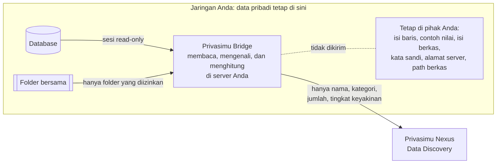
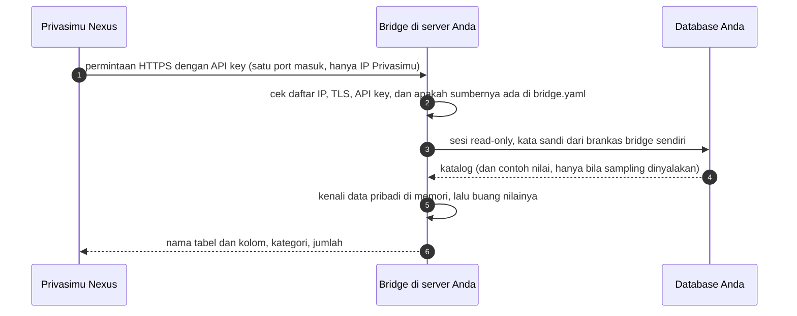
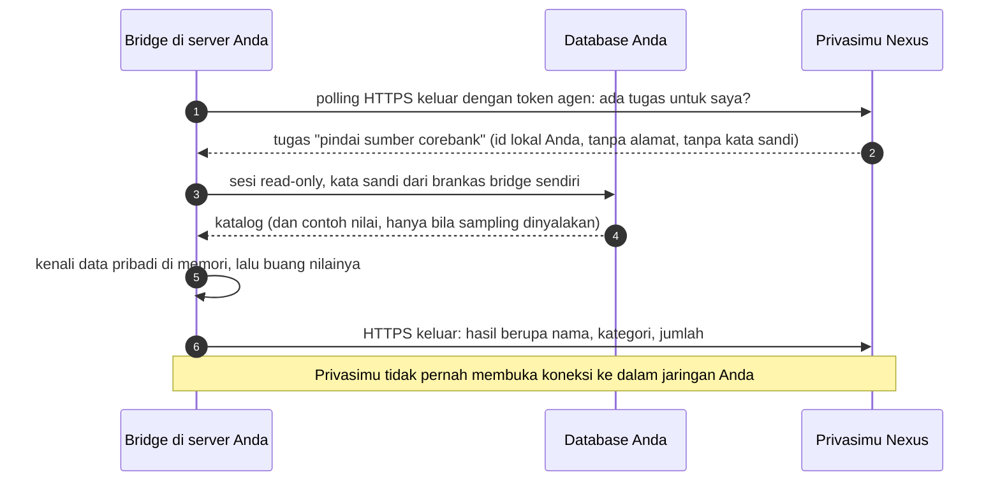

# Privasimu Bridge

**English:** [README.md](README.md)

Privasimu Bridge membantu **Privasimu Data Discovery** mendata data pribadi di database dan
folder bersama (file share) **di dalam jaringan perusahaan Anda**, tanpa datanya keluar dari
jaringan itu. Bridge adalah satu program yang dipasang di server Anda, dekat dengan datanya.
Bridge membaca katalog database dan berkas di sana, mengenali data pribadi di sana, lalu hanya
mengirim **nama, jenis, kategori data pribadi, jumlah, dan tingkat keyakinan**. Isi data,
contoh nilai, dan isi berkas tidak pernah keluar.

- **Mode A** (sudah berjalan): Privasimu menghubungi bridge lewat HTTPS dengan kontrak bridge
  yang sudah ada (kontrak v1). Privasimu tidak perlu diubah.
- **Mode B**: bridge yang menghubungi Privasimu untuk mengambil tugas dan mengirim hasil,
  jadi perusahaan **tidak perlu membuka port masuk** di firewall.

## Bagaimana data Anda tetap di jaringan Anda

Semua pembacaan dan pengenalan data dilakukan bridge di server Anda. Yang melewati batas
jaringan hanya hasil temuannya.



### Mode A: Privasimu yang menghubungi bridge



- Anda membuka satu port HTTPS di bridge dan hanya mengizinkan alamat IP keluar milik
  Privasimu. Alamat lain diputus sebelum koneksi TLS dimulai.
- Dengan pengaturan bawaan **local credentials**, Privasimu hanya bisa memindai sumber yang
  tercantum di `bridge.yaml` milik bridge, dan kata sandi yang diketik di Privasimu diabaikan.
  Alias di `match.host` membuat alamat asli database tidak pernah diketahui Privasimu.

### Mode B: bridge yang menghubungi Privasimu (tanpa port masuk)



- Firewall Anda cukup mengizinkan HTTPS keluar dari bridge ke Privasimu.
- Privasimu hanya mengenal sumber Anda dari id, label, dan jenis database yang Anda atur.
  Alamat server, port, nama pengguna, dan kata sandi tetap di bridge.
- Sebuah tugas hanya bisa mempersempit pemindaian (skema lebih sedikit, batas lebih kecil,
  sampling dimatikan), tidak pernah memperluasnya.

### Pilih Mode A atau Mode B?

| | Mode A | Mode B |
|---|---|---|
| Siapa yang membuka koneksi | Privasimu → bridge | bridge → Privasimu |
| Port masuk di firewall Anda | ya, satu port HTTPS untuk IP Privasimu | **tidak** |
| Sertifikat TLS di bridge | ya | tidak (bridge yang memeriksa sertifikat Privasimu) |
| Kata sandi database | di bridge (bawaan: local credentials) | selalu di bridge |
| Yang diketahui Privasimu tentang sumber | jenis database, host (atau alias Anda), nama database | hanya id, label, dan jenis database yang Anda atur |
| Pemindaian folder bersama | masih usulan, mati secara bawaan | ya |
| Pemindaian perangkat lunak | tidak | sudah ada di agen; sisi platform sedang dikerjakan |
| Cocok untuk | Privasimu on-premise di jaringan Anda, pemasangan kontrak v1 yang sudah ada | Privasimu SaaS, bank dan jaringan lain yang tidak boleh membuka port masuk |

### Yang keluar dan yang tidak pernah keluar

| Keluar dari jaringan Anda | Tidak pernah keluar |
|---|---|
| nama tabel, koleksi, dan kolom; tipe data; perkiraan jumlah baris | isi baris, contoh nilai, dokumen |
| kategori data pribadi, kategori UU PDP (`umum` / `spesifik`), tingkat keyakinan | nilai yang cocok atau potongannya |
| jumlah: nilai yang diperiksa, nilai yang cocok, jumlah per kategori per berkas | isi berkas dan teks hasil ekstraksi |
| status perlindungan kolom (polos, disamarkan, terenkripsi, campuran) | kunci, ciphertext, nilai yang disamarkan |
| id berkas (hash berkunci), ekstensi, ukuran, tanggal; path relatif hanya bila `report_paths: relative` | path lengkap, pemilik berkas |
| id dan label sumber yang Anda atur (Mode B) | alamat server, port, nama pengguna, kata sandi (Mode B); kata sandi (Mode A, local credentials) |
| jenis dan kode galat | pesan galat dari driver database (bisa memuat nilai) |

Tabel lengkapnya, termasuk pemindaian perangkat lunak dan inventaris akses opsional, ada di
[docs/DESIGN.md](docs/DESIGN.md) bagian 7 (bahasa Inggris).

## Tanya jawab

### Untuk tim keamanan, kepatuhan, dan DPO

**Apakah data pribadi kami pernah keluar dari server kami?**
Tidak. Bridge membaca database dan berkas di server Anda, mengenali data pribadi di sana, dan
hanya mengirim nama, kategori, dan jumlah. Tidak ada endpoint (Mode A) maupun pesan (Mode B)
yang membawa isi baris, contoh nilai, atau isi berkas. Sampling, yaitu membaca beberapa nilai
per kolom untuk mengenali NIK atau nomor telepon, mati secara bawaan. Bila dinyalakan, setiap
nilai hanya diperiksa di memori bridge lalu dibuang.

**Bisakah Privasimu, atau orang yang membobol Privasimu, menarik data kami lewat bridge?**
Tidak. Bridge tidak punya fungsi yang mengembalikan isi baris, contoh nilai, atau isi berkas,
jadi tidak ada yang bisa dipanggil. Secara bawaan bridge hanya memindai sumber yang Anda
cantumkan di `bridge.yaml` miliknya, dengan kata sandi yang hanya dipegang bridge. Di Mode B,
tugas hanya menyebut sumber dengan id lokal Anda dan hanya bisa mempersempit pemindaian.
Yang bisa dilihat penyusup di Privasimu hanyalah metadata yang memang sudah ditampilkan
Privasimu: nama tabel, nama kolom, dan jumlah.

**Di mana kata sandi database kami disimpan? Apakah Privasimu melihatnya?**
Di server bridge: di brankas terenkripsi (AES-256-GCM; di Windows kuncinya disegel dengan
DPAPI), atau di variabel lingkungan atau berkas yang Anda pilih. `bridge.yaml` hanya berisi
rujukan, dan kata sandi yang ditulis langsung di dalamnya ditolak. Di Mode B, Privasimu tidak
pernah menerima alamat server, port, nama pengguna, maupun kata sandi. Di Mode A dengan local
credentials bawaan, kata sandi yang diketik di Privasimu diabaikan.

**Apakah kami harus membuka port di firewall?**
Mode B: tidak, bridge hanya melakukan panggilan HTTPS keluar ke Privasimu. Mode A: ya, satu
port HTTPS di bridge, yang Anda batasi hanya untuk alamat IP keluar milik Privasimu.

**Apakah pemindaian bisa mengubah data atau memperlambat sistem produksi?**
Bridge hanya membaca. Setiap jenis database dibaca dalam mode read-only: sesi read-only bila
database mendukungnya (misalnya PostgreSQL `default_transaction_read_only`, MySQL dan MariaDB
`SET SESSION TRANSACTION READ ONLY`), atau cakupan token read-only dan permintaan GET saja
untuk layanan cloud. Panduan pemasangan juga meminta Anda membuat akun database yang hanya
punya hak `SELECT`. Setiap query punya batas waktu yang dijaga server database, paling banyak
4 koneksi per sumber, dan sampling hanya membaca baris dalam jumlah terbatas. Query katalog
pada database yang sangat besar tetap membebani server sedikit, jadi jalankan pemindaian besar
di luar jam sibuk.

**Bagaimana dengan berkas di folder bersama?**
Hanya folder yang Anda izinkan di pengaturan lokal bridge yang dipindai. Tautan (link) dan
junction yang mengarah ke luar folder itu ditolak, dan PDF dibaca di proses terpisah dengan
batas waktu. Privasimu menerima id berkas (hash berkunci), ekstensi, ukuran, tanggal, dan
jumlah temuan per berkas. Isi berkas, teks, pemilik, dan path lengkapnya tidak pernah dikirim.

**Apakah data kami dikirim ke AI?**
Bridge tidak mengirim nilai ke mana pun, jadi Privasimu dan fitur AI-nya tidak pernah
menerimanya. Deteksi opsional dengan model bahasa (`detection.nlp`, mati secara bawaan) hanya
mengirim teks ke layanan model milik Anda sendiri, di server bridge atau jaringan internal
Anda, dan yang disimpan hanya jumlahnya.

**Bagaimana kalau API key atau token agen bocor?**
Kunci berukuran 256 bit dan hanya disimpan sebagai hash SHA-256. Percobaan gagal berulang
dikunci, dan ada batas laju permintaan. Cabut kunci Mode A dengan
`privasimu-bridge key revoke`, atau cabut dan ganti token agen di Privasimu (Mode B). Selama
belum dicabut, kunci Mode A yang bocor hanya bisa melihat nama sumber yang sudah Anda atur.

**Bagaimana kami memeriksa apa saja yang dilakukan bridge?**
Setiap permintaan dan tugas dicatat di log audit (JSON lines) di server bridge, tanpa nilai
apa pun. Kode sumbernya ada di repositori ini, dan rilisnya ditandatangani (lihat bagian
"Verify the download" di [README.md](README.md#verify-the-download)).

**Mode mana yang sebaiknya kami pilih?**
Bila Anda memakai Privasimu versi cloud (SaaS), pilih Mode B: tidak ada port masuk yang dibuka
di firewall Anda. Bila Privasimu dipasang di jaringan Anda sendiri, keduanya bisa; Mode B juga
menjaga alamat server tetap di bridge dan menambah pemindaian folder bersama.

### Untuk developer dan operator

**Di bagian kode mana batasnya dijaga?**
Server Mode A ada di `internal/server`; hanya endpoint nama dan temuan yang tersedia. Kontrak
pesan Mode B ada di `internal/agent/protocol.go`. Pengenalan data hanya menyimpan jumlah:
`internal/detect`.

**Uji mana yang membuktikan nilai tidak pernah keluar?**

| Uji | Paket | Yang diperiksa |
|---|---|---|
| `TestResultsNeverCarryValues` | `internal/detect` | hasil deteksi tidak memuat nilai yang diperiksa |
| `TestPlatformScanWithLocalSampling` | `internal/server` | jawaban Mode A tidak memuat contoh nilai |
| `TestInventoryNamesSourcesWithoutAddressesOrPaths` | `internal/agent` | inventaris Mode B tanpa host, alamat, atau path |
| `TestSamplingCanOnlyBeNarrowedByThePlatform` | `internal/agent` | platform tidak bisa menyalakan sampling |
| `TestSymlinksNeverLeaveTheRoot` | `internal/files` | pemindaian berkas tetap di folder yang diizinkan |
| `TestValuesNeverPrint` | `internal/secrets` | rahasia tidak pernah muncul di keluaran |

```sh
go test ./internal/detect -run '^TestResultsNeverCarryValues$'
go test ./internal/server -run '^TestPlatformScanWithLocalSampling$'
go test ./internal/agent -run '^(TestInventoryNamesSourcesWithoutAddressesOrPaths|TestSamplingCanOnlyBeNarrowedByThePlatform)$'
```

**Apakah Privasimu perlu diubah untuk setiap mode?**
Mode A memakai kontrak v1 yang sudah ada, jadi tidak. Mode B memakai rute agen
`/api/bridge-agent/v1`, yang sudah ada di kedua lini platform (Laravel dan Go); protokolnya di
[docs/AGENT-PROTOCOL.md](docs/AGENT-PROTOCOL.md).

**Di mana sumber data diatur?**
Di `bridge.yaml`; semua opsinya diberi keterangan di
[examples/bridge.example.yaml](examples/bridge.example.yaml). Panduan langkah demi langkah:
[docs/INSTALL.id.md](docs/INSTALL.id.md).

## Yang bisa dipindai

- **Database:** PostgreSQL, MySQL dan MariaDB, Microsoft SQL Server, Oracle, MongoDB, dan di
  Mode B mulai protokol agen revisi 4: Amazon Redshift, ClickHouse, Snowflake (juga Mode A),
  Google BigQuery, Databricks SQL, dan Amazon Athena (katalog saja). Tidak perlu Oracle Instant
  Client maupun ODBC.
- **Berkas:** TXT, CSV, JSON dan teks lain, DOCX, XLSX, teks PDF.
- **Perangkat lunak** (Mode B, opsional): paket yang terpasang di server, folder, atau arsip
  image container, untuk postur keamanan per RoPA. Yang keluar hanya nama paket, versi,
  lisensi, dan id kerentanan.
- **Identitas Indonesia** diperiksa di server Anda: NIK, KK, NPWP, BPJS, nomor telepon +62/08,
  kartu pembayaran (Luhn), dan lainnya.
- **Siapa yang bisa membaca tabel** (opsional; PostgreSQL, MySQL, MariaDB): jumlah akun dan
  peran grup, tanpa pernah menyebut akun yang bisa login. Nama peran dikirim sebagai hash
  berkunci, kecuali Anda memilih `access_inventory.role_names: plain`.

## Mulai cepat

Mode B (bridge yang menghubungi Privasimu; tanpa port masuk, tanpa sertifikat):

```sh
privasimu-bridge init --mode b --platform-url https://privasimu.example.co.id
privasimu-bridge secret set corebank_pg                 # kata sandi database, tidak ditampilkan
# tambahkan sumber atau folder ke bridge.yaml (lihat examples/)
privasimu-bridge agent enroll --token pvbe_...          # token dari Privasimu, menu bridge agents
privasimu-bridge check                                  # juga menyebut masalah TLS dan Basic Auth
privasimu-bridge service install --mode agent
```

Mode A (Privasimu yang menghubungi bridge):

```sh
privasimu-bridge init --mode a --public-url https://bridge.example.co.id:8443   # menampilkan API key sekali
privasimu-bridge secret set corebank_pg                                         # kata sandi database, tidak ditampilkan
# taruh sertifikat TLS di tls/, tambahkan sumber ke bridge.yaml (lihat examples/)
privasimu-bridge check
privasimu-bridge service install --mode serve
```

Panduan lengkap: [docs/INSTALL.id.md](docs/INSTALL.id.md). Perintah bridge juga bisa berbahasa
Indonesia (`--lang id` atau `PRIVASIMU_BRIDGE_LANG=id`).

Rincian keamanan dan model ancaman: [docs/DESIGN.md](docs/DESIGN.md) (bahasa Inggris).
