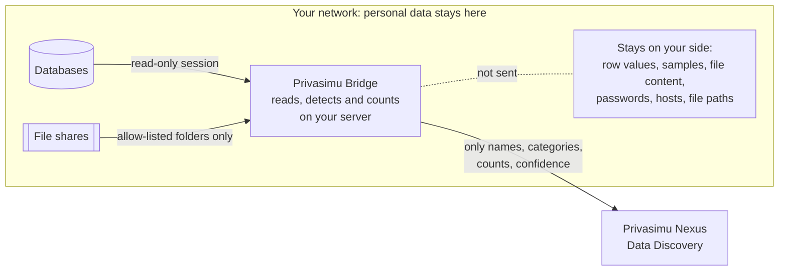
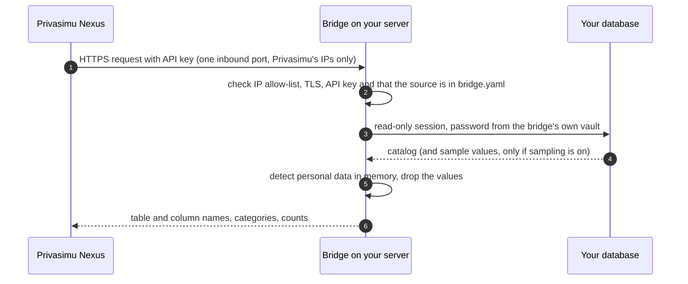
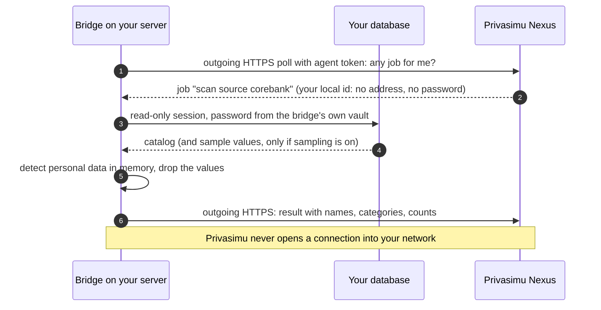

# Privasimu Bridge

**Bahasa Indonesia:** [README.id.md](README.id.md)

Privasimu Bridge lets **Privasimu Data Discovery** inventory personal data in databases and
file shares **inside a client's network** without the data leaving it. It is one static
binary that runs on a server next to the data, reads database catalogs and files there,
detects personal data there, and reports only **names, types, personal-data categories,
counts and confidence**. Values, samples and file content never leave.

- **Mode A** (works today): Privasimu calls the bridge over HTTPS with the existing
  bridge contract (contract v1). No change to Privasimu is needed.
- **Mode B** (agent and both platform lines): the bridge polls Privasimu for jobs and
  posts results, so the client opens **no inbound port**.

## How your data stays inside your network

The bridge does all the reading and detecting on your server. Only the findings cross your
network boundary.



### Mode A: Privasimu calls the bridge



- You open one HTTPS port on the bridge and allow only Privasimu's outgoing IP addresses;
  other addresses are cut off before the TLS handshake.
- With the default **local credentials**, Privasimu can only scan the sources listed in the
  bridge's own `bridge.yaml`, and a password typed in Privasimu is ignored. An alias in
  `match.host` keeps the real database address out of Privasimu.

### Mode B: the bridge calls Privasimu (no inbound port)



- Your firewall only needs to allow outgoing HTTPS from the bridge to Privasimu.
- Privasimu knows your sources only by the id, label and engine you configure; hosts, ports,
  user names and passwords stay on the bridge.
- A job can only narrow a scan (fewer schemas, lower limits, sampling off), never widen it.

### Mode A or mode B?

| | Mode A | Mode B |
|---|---|---|
| Who opens the connection | Privasimu → bridge | bridge → Privasimu |
| Inbound port on your firewall | yes, one HTTPS port for Privasimu's IPs | **no** |
| TLS certificate on the bridge | yes | no (the bridge checks Privasimu's certificate) |
| Database passwords | on the bridge (default local credentials) | always on the bridge |
| What Privasimu knows about a source | engine, host (or your alias) and database name | only the id, label and engine you configure |
| File-share scans | a proposal, off by default | yes |
| Software scans | no | in the agent; platform side in progress |
| Good fit | Privasimu on-premise in your network, existing contract v1 setups | Privasimu SaaS, banks and other networks without inbound ports |

### What leaves and what never leaves

| Leaves your network | Never leaves |
|---|---|
| table, collection and column names, data types, row estimates | row values, samples, documents |
| personal-data category, UU PDP category (`umum` / `spesifik`), confidence | the matched values or any part of them |
| counts: sampled values, matching values, per-category counts per file | file content and extracted text |
| protection state of a column (plaintext, masked, encrypted, mixed) | keys, ciphertext, masked strings |
| file id (keyed hash), extension, size, date; the relative path only with `report_paths: relative` | absolute paths, file owners |
| source ids and labels you configure (mode B) | hosts, ports, user names and passwords (mode B); passwords (mode A, local credentials) |
| error kinds and codes | driver error messages (they can quote values) |

The full table, including software scans and the optional access inventory, is in
[docs/DESIGN.md](docs/DESIGN.md) section 7.

## Questions and answers

### For security, compliance and DPO teams

**Does our personal data ever leave our server?**
No. The bridge reads your databases and files on your server, recognises personal data
there, and sends only names, categories and counts. There is no endpoint (mode A) and no
message (mode B) that carries row values, samples or file content. Sampling, which reads a
few values per column to recognise things like NIK or phone numbers, is off by default.
When it is on, each value is examined in memory on the bridge and dropped.

**Can Privasimu, or someone who breaks into Privasimu, pull our data through the bridge?**
No. The bridge has no function that returns rows, samples or file content, so there is
nothing to call. By default it scans only the sources you list in its own `bridge.yaml`,
with passwords only it holds. In mode B a job names a source only by your local id and can
only narrow a scan. What an intruder in Privasimu could see is the metadata Privasimu
already shows: table and column names and counts.

**Where are our database passwords kept? Does Privasimu see them?**
On the bridge server: in an encrypted store (AES-256-GCM; on Windows the key is sealed with
DPAPI), or in environment variables or files you choose. `bridge.yaml` holds only
references, and a password written in it is refused. In mode B Privasimu never receives
hosts, ports, user names or passwords. In mode A with the default local credentials, a
password typed in Privasimu is ignored.

**Do we have to open a port in our firewall?**
Mode B: no, the bridge only makes outgoing HTTPS calls to Privasimu. Mode A: yes, one HTTPS
port on the bridge, which you limit to Privasimu's outgoing IP addresses.

**Can the scan change our data or slow down production?**
The bridge only reads. Every engine is read in read-only mode: read-only sessions where the
database has them (for example PostgreSQL `default_transaction_read_only`, MySQL and MariaDB
`SET SESSION TRANSACTION READ ONLY`), a read-only token scope or GET-only requests for the
cloud services. The install guide also has you create a database account with `SELECT`
rights only. Queries have time limits enforced by the database server, at most 4
connections per source are used, and sampling reads a bounded number of rows. Catalog
queries on very large databases still cost the server some work, so run large scans outside
busy hours.

**What happens with files on our file shares?**
Only folders you allow in the bridge's local configuration are scanned. Links and junctions
that point out of those folders are refused, and PDFs are parsed in a separate process with
a time limit. Privasimu receives a keyed-hash id, extension, size, date and counts per file,
never its content, text, owner or absolute path.

**Is our data sent to an AI?**
The bridge sends no values to anyone, so Privasimu and its AI features never receive them.
The optional language-model detection (`detection.nlp`, off by default) sends text only to a
model service you run on the bridge server or your internal network; only its counts are
kept.

**What if the API key or agent token leaks?**
Keys are 256-bit and stored only as SHA-256 hashes; repeated failures lock out and rate
limits apply. Revoke a mode A key with `privasimu-bridge key revoke`, or revoke or rotate the
agent in Privasimu (mode B). Until it is revoked, a leaked mode A key can only list the
names of the sources you configured.

**How can we check what the bridge did?**
Every request and job is written to a JSON-lines audit log on the bridge server, without
any value. The source code is in this repository, and releases are signed (see
[Verify the download](#verify-the-download)).

**Which mode should we choose?**
With Privasimu as a cloud service (SaaS), choose mode B: nothing on your firewall opens
inward. With Privasimu installed in your own network, either works; mode B also keeps hosts
out of Privasimu and adds file-share scans.

### For developers and operators

**Where is the boundary enforced in the code?**
The mode A server is `internal/server`; only the name and finding endpoints exist. The mode B
wire contract is `internal/agent/protocol.go`. Detection keeps counts only:
`internal/detect`.

**Which tests prove that values never leave?**

| Test | Package | What it checks |
|---|---|---|
| `TestResultsNeverCarryValues` | `internal/detect` | detection results hold no sampled value |
| `TestPlatformScanWithLocalSampling` | `internal/server` | a mode A response carries no sampled value |
| `TestInventoryNamesSourcesWithoutAddressesOrPaths` | `internal/agent` | the mode B inventory has no host, address or path |
| `TestSamplingCanOnlyBeNarrowedByThePlatform` | `internal/agent` | the platform cannot switch sampling on |
| `TestSymlinksNeverLeaveTheRoot` | `internal/files` | file scans stay inside the allowed folders |
| `TestValuesNeverPrint` | `internal/secrets` | secrets never appear in output |

```sh
go test ./internal/detect -run '^TestResultsNeverCarryValues$'
go test ./internal/server -run '^TestPlatformScanWithLocalSampling$'
go test ./internal/agent -run '^(TestInventoryNamesSourcesWithoutAddressesOrPaths|TestSamplingCanOnlyBeNarrowedByThePlatform)$'
```

**Does Privasimu need changes for each mode?**
Mode A uses the existing contract v1, so no. Mode B uses the agent routes
`/api/bridge-agent/v1`, implemented in both platform lines; the protocol is
[docs/AGENT-PROTOCOL.md](docs/AGENT-PROTOCOL.md).

**Where do I configure a source?**
In `bridge.yaml`; every option is commented in
[examples/bridge.example.yaml](examples/bridge.example.yaml). Step-by-step guides:
[docs/INSTALL.en.md](docs/INSTALL.en.md) and [docs/INSTALL.id.md](docs/INSTALL.id.md).

## What it can scan

- **Databases:** PostgreSQL, MySQL and MariaDB, Microsoft SQL Server, Oracle, MongoDB, and in
  mode B from agent protocol revision 4 Amazon Redshift, ClickHouse, Snowflake (also mode A),
  Google BigQuery, Databricks SQL and Amazon Athena (catalog only). The drivers are pure Go;
  ClickHouse and the cloud warehouses go over their HTTP APIs with the standard library, so
  no Oracle Instant Client or ODBC is needed.
- **Files:** TXT, CSV, JSON and other text, DOCX, XLSX, PDF text.
- **Software** (mode B, opt-in): installed packages of a host, a directory or a local
  container image archive, with Syft, matched against vulnerability data with Grype or Trivy,
  for the security posture per RoPA. Only package names, versions, licences and
  vulnerability ids leave.
- **Indonesian identifiers** are validated locally: NIK, KK, NPWP, BPJS, +62/08 phone numbers,
  payment cards with Luhn, and more.
- **Free text** (optional): long text can also go to your own language-model service on the
  bridge server or your network (names, addresses, health and the like); only its counts are
  used.
- **Who can read a table** (optional; PostgreSQL, MySQL, MariaDB): counts and group roles,
  never the names of accounts that can sign in. Role names leave as keyed hashes unless you
  set `access_inventory.role_names: plain`.

## Works with both Privasimu Nexus lines (Laravel and Go)

Privasimu Nexus has two backend lines that stay in sync: the **Laravel line**
(priva-back, api-privasimu-nexus) and the **Go line** (go-api-privasimu-nexus). The
**same bridge binary works with both**:

- In mode A both lines use the identical contract v1: Laravel
  `App\Services\Discovery\Bridge\BridgeClient` and Go `internal/dbscan/bridge.go` call
  `/v1/name-database-tabels` and `/v2/scan-table-columns` with the same headers
  (`X-API-Key`, `X-Contract-Version: 1`) and the same field mapping (`BridgeSourceTypes`).
  The test suite replays both clients, including the bytes where they differ (JSON
  encoding, compression, concurrency); see [docs/DESIGN.md](docs/DESIGN.md) section 2.2.
- Mode B is specified once, in [docs/AGENT-PROTOCOL.md](docs/AGENT-PROTOCOL.md), and both
  platforms implement it byte-identically; the Laravel line verified it end to end with
  this binary.

**Why a Go binary and not PHP**: the bridge runs on the client's server. As one static
file it needs no PHP, Composer, web server, PHP-FPM or database extensions (`oci8` with
Instant Client, `sqlsrv` with the ODBC driver, ...); its Oracle and SQL Server drivers
are pure Go. The same binary runs as a Windows service, a systemd unit or a container.

## Verify the download

Releases are signed (see [docs/RELEASE-SIGNING.md](docs/RELEASE-SIGNING.md)): `SHA256SUMS`
with minisign, the container images with cosign. With the release files and the public
keys from [`release-keys/`](release-keys/) in one folder:

```sh
minisign -Vm SHA256SUMS -x SHA256SUMS.sig -p minisign.pub   # signature of the checksums
sha256sum -c SHA256SUMS --ignore-missing                    # checksums of the binaries
cosign verify --key cosign.pub privasimu-bridge:<version>-scan   # an image
```

(`scripts/release/verify.sh <folder>` runs the first two.) The release keys have not been
generated yet: `release-keys/` holds clearly marked placeholders until the owner publishes
the real public keys, and the scripts refuse to sign or verify with a placeholder.

## Quick start

Mode B (the bridge polls Privasimu; no inbound port, no certificate):

```sh
privasimu-bridge init --mode b --platform-url https://privasimu.example.co.id
privasimu-bridge secret set corebank_pg                 # database password, no echo
# add sources or file roots to bridge.yaml (see examples/)
privasimu-bridge agent enroll --token pvbe_...          # token from Privasimu, bridge agents
privasimu-bridge check                                  # also names TLS and Basic Auth problems
privasimu-bridge service install --mode agent
```

Mode A (Privasimu calls the bridge):

```sh
privasimu-bridge init --mode a --public-url https://bridge.example.co.id:8443   # prints the API key once
privasimu-bridge secret set corebank_pg                                         # database password, no echo
# put the TLS certificate in tls/, add sources to bridge.yaml (see examples/)
privasimu-bridge check
privasimu-bridge service install --mode serve
```

In mode A, add a system of the same database type in Privasimu Data Discovery, open
**Bridge service (optional)** and enter the bridge address and the API key. Full guides:

- [docs/INSTALL.en.md](docs/INSTALL.en.md) (English)
- [docs/INSTALL.id.md](docs/INSTALL.id.md) (Bahasa Indonesia)

## Security in short

- Only the endpoints that return names and findings exist; endpoints that return rows,
  samples or file content do not.
- Database passwords stay on the bridge by default ("local credentials"): Privasimu can
  only scan sources listed in the bridge's own configuration.
- The configuration holds no secret: passwords are references to an encrypted store
  (AES-256-GCM; DPAPI on Windows), environment variables or files. API keys are stored as
  SHA-256 hashes and compared in constant time; lockout and rate limits apply.
- TLS 1.2+ (HTTP/1.1 only), client IP allow-list before the TLS handshake.
- Databases are read in read-only sessions with timeouts and bounded concurrency.
- File shares: only allow-listed roots; links and junctions that leave a root are
  refused (`os.Root`); PDFs are parsed in a separate process with a timeout.
- A JSON-lines audit log records every request and job without any value.

Details and the threat model: [docs/DESIGN.md](docs/DESIGN.md).

## Repository

| Path | Content |
|---|---|
| `cmd/privasimu-bridge` | the binary |
| `internal/` | detection, database access, file scanning, mode A server, mode B agent, CLI |
| `docs/DESIGN.md` | architecture, threat model, both modes, platform work list, comparison checklist |
| `docs/AGENT-PROTOCOL.md`, `docs/agent-protocol/errors.json` | the mode B platform contract (revision 3: package scans) |
| `docs/RELEASE-SIGNING.md`, `release-keys/`, `scripts/release/` | release signing (minisign, cosign) and verification |
| `docs/INSTALL.en.md`, `docs/INSTALL.id.md` | installation tutorials |
| `README.id.md` | this page in Bahasa Indonesia |
| `examples/bridge.example.yaml` | every configuration option, commented |
| `deploy/` | systemd unit, Docker Compose, nginx examples |
| `Dockerfile`, `Dockerfile.scan`, `Makefile` | container images (default, and `-scan` with pinned Syft and Grype), release builds |
| `THIRD_PARTY_NOTICES.md` | linked modules and licences |

## Development

Requires Go 1.26.10.

```sh
go test ./...                    # unit, contract, security and fake-platform tests
go vet ./... && GOOS=linux go vet ./...
govulncheck ./...
make dist VERSION=0.1.0          # static builds for linux/amd64, linux/arm64, windows/amd64
make integration                 # needs the BRIDGE_IT_* variables of internal/testutil/itenv
```

The command line speaks English and Indonesian (`--lang id` or
`PRIVASIMU_BRIDGE_LANG=id`).

## Status

0.1.0-dev. Mode A is complete and tested against both platform clients. Mode B and file
scanning are implemented in both platform lines (agent protocol revision 2; see
[docs/DESIGN.md](docs/DESIGN.md) section 12 for the frontend work). Package scans
(`scan_packages`, agent protocol revision 3) are implemented in the agent and tested with
fake scanners; the platform side is in progress in both lines. The database integration
tests ran against PostgreSQL 16.6 and MariaDB 11.8.9 (catalog, sampling, read-only and
time-limited sessions, error kinds, both modes end to end); MySQL 8, SQL Server, Oracle and
MongoDB have not been run against live servers yet.
