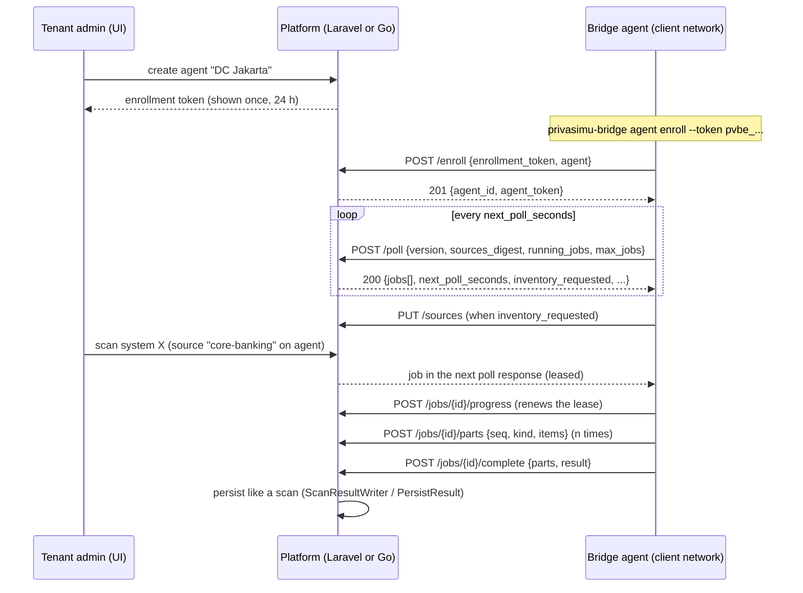

# Agent protocol 1 (mode B): platform contract

Status: **proposal, normative for implementers**. The agent side is implemented and tested
in this repository (`internal/agent`, against an in-memory platform that follows this
document). The platform side does not exist yet in either Privasimu Nexus line.

This document is the single contract for **both platform lines**: the Laravel backend
(`backend`, repositories priva-back and api-privasimu-nexus) and the Go backend
(`backend-go`, go-api-privasimu-nexus), and for both frontends. The two backends must
produce **byte-identical** responses for the same state: same routes, statuses, JSON keys
and key order, error codes and messages. The rules in section 2 make that possible with
`json_encode` and `encoding/json`.

Machine-readable parts: [`agent-protocol/errors.json`](agent-protocol/errors.json) (every
error code, status and exact message). Both backends should load it in their tests.

Contents: 1 Model · 2 Wire conventions · 3 Authentication and tokens · 4 Check order ·
5 Agent API · 6 Jobs, leases and results · 7 Persisting results · 8 Tenant API ·
9 Data model · 10 Scheduler · 11 Limits · 12 Test plan.

## 1. Model



The agent never listens on a port. It names what it may scan (its **inventory**: database
sources and file roots from its local configuration, by id, without hosts, paths or
credentials). The platform creates **jobs** that name an inventory id; it can never send
a host, a path, a credential, a query or anything that widens what the local
configuration allows.

## 2. Wire conventions

- Base path: `{platform_url}/api/bridge-agent/v1`. The agent's `platform_url` has no
  trailing slash and no path in the default deployments; a path prefix is allowed.
- Transport: HTTPS only (TLS 1.2+). No redirects: a 3xx is an error for the agent.
- Every request from the agent carries:
  `Content-Type: application/json`, `Accept: application/json`,
  `User-Agent: privasimu-bridge/<version>`, `X-Bridge-Protocol: 1`, and except for
  `/enroll`, `Authorization: Bearer <agent_token>`. Job routes also carry
  `X-Lease-Token: <lease_token>`.
- Every platform response carries `Content-Type: application/json`,
  `Cache-Control: no-store, private` and `X-Bridge-Protocol: 1`; 429 and 503 carry
  `Retry-After: <integer seconds>`. Other headers (Date, Server, rate-limit headers) may
  differ between the lines; the agent ignores them.

**Canonical JSON** (every platform response body):

| Rule | Laravel | Go |
|---|---|---|
| Compact, no whitespace, no trailing newline | `json_encode` default | `Encoder.Encode` then trim the `\n` |
| Keys in the order this document lists them | ordered PHP arrays | struct field order (never `map` for objects) |
| `/` not escaped; non-ASCII as raw UTF-8 | `JSON_UNESCAPED_SLASHES \| JSON_UNESCAPED_UNICODE` | default |
| `<`, `>`, `&` not escaped | default | `Encoder.SetEscapeHTML(false)` |
| U+2028 and U+2029 escaped as `
`, `
` | default (without `JSON_UNESCAPED_LINE_TERMINATORS`) | default |
| Control characters: `\b \f \n \r \t`, others `\u00xx` (lower-case hex) | default | default (Go 1.22+) |
| Invalid UTF-8 replaced by U+FFFD | `JSON_INVALID_UTF8_SUBSTITUTE` | default |
| Empty object is `{}` (e.g. `options`) | `new \stdClass` / `(object) []` | struct or empty map |
| Empty list is `[]`, never `null` | `[]` | initialise slices |
| Integers only (no floats in platform responses) | `int` casts | `int` fields |
| Timestamps: UTC, seconds, literal `Z`: `2026-10-31T12:00:00Z` | `->utc()->format('Y-m-d\TH:i:s\Z')` | `t.UTC().Format("2006-01-02T15:04:05Z")` |
| UUIDs lower-case with hyphens | `Str::uuid()->toString()` | `uuid.NewString()` |
| Every documented key is present; a missing value is `null` | | pointer fields without `omitempty` |

Exception: `options` of a job lists only the options that were set (section 6.2).

**Errors** always use the envelope
`{"error":{"code":"<code>","message":"<message>"}}` with the status and the exact English
message of [`errors.json`](agent-protocol/errors.json):

| Code | Status | Message |
|---|---|---|
| `invalid_request` | 400 | The request is not valid. |
| `unauthenticated` | 401 | The agent token is missing or not valid. |
| `agent_revoked` | 401 | This agent has been revoked. |
| `enrollment_invalid` | 401 | The enrollment token is not valid, already used or expired. |
| `forbidden` | 403 | This agent may not perform this action. |
| `not_found` | 404 | Not found. |
| `job_not_found` | 404 | The job does not exist for this agent. |
| `method_not_allowed` | 405 | This method is not allowed here. |
| `lease_expired` | 409 | The job lease is not valid or has expired. |
| `part_conflict` | 409 | A different part with this number was already received. |
| `parts_incomplete` | 409 | Not every part of the result has been received. |
| `payload_too_large` | 413 | The request body is too large. |
| `unsupported_media_type` | 415 | The request body must be JSON. |
| `protocol_unsupported` | 426 | This agent protocol version is not supported; upgrade the bridge. |
| `rate_limited` | 429 | Too many requests; retry later. |
| `server_error` | 500 | Internal error. |
| `maintenance` | 503 | The service is temporarily unavailable; retry later. |

Example (exact bytes):
`{"error":{"code":"lease_expired","message":"The job lease is not valid or has expired."}}`.
No error carries field details, a stack trace, a tenant name or any submitted value.
Laravel must render these envelopes for 404/405/413/419/500 under the agent prefix
instead of the framework's default error pages (route-prefixed exception rendering).

## 3. Authentication and tokens

| Token | Format | Issued | Stored by the platform |
|---|---|---|---|
| Enrollment token | `pvbe_` + 43 chars of base64url (32 random bytes) | when the admin creates the agent (or renews the token) | SHA-256, lower-case hex, 64 chars |
| Agent token | `pvba_` + 43 chars base64url | on enroll and on rotate | SHA-256 hex (current and previous) |
| Lease token | `pvbl_` + 43 chars base64url | when a job is leased | SHA-256 hex |

- Tokens are random (CSPRNG). The platform returns a token in clear exactly once and
  stores only the hash; it looks a token up by its hash and compares hashes with a
  constant-time compare.
- Enrollment tokens expire after 24 hours and are single-use.
- Agent token lookup is cross-tenant (the token identifies the tenant). In the Laravel
  line on PostgreSQL with RLS this lookup must run inside
  `CurrentOrgContext::lintasTenant()`; afterwards the middleware sets the organization
  context from the agent row, then applies `tenant.db` (BYODB) and `tenant.readonly`.
- An agent with status `revoked` gets `401 agent_revoked`; a `pending` agent (not enrolled)
  or an unknown token gets `401 unauthenticated`.
- Rotation: the new token is valid at once; the previous one stays valid for 600 seconds
  (`previous_valid_seconds`) so a lost response cannot lock the agent out.

## 4. Check order

Both backends check in this order and answer with the first failure:

1. Route and method: `404 not_found`, `405 method_not_allowed` (with `Allow`).
2. `X-Bridge-Protocol` must be exactly `1`: else `426 protocol_unsupported`.
3. Body size (`Content-Length` or the bytes read): parts 1 048 576 bytes, every other route
   65 536 bytes: else `413 payload_too_large`.
4. `Content-Type` must be `application/json` (parameters such as `charset` allowed): else
   `415 unsupported_media_type`.
5. Authentication (not for `/enroll`): `401 unauthenticated` / `401 agent_revoked`.
6. Rate limit (section 11): `429 rate_limited` with `Retry-After`.
7. Tenant in migration (`tenant.readonly`: freezing or migrating): `503 maintenance` with
   `Retry-After: 60`. For `/enroll` this check runs after step 9's token lookup.
8. Body: one JSON object (not an array, not empty), field rules of section 5:
   `400 invalid_request`. Unknown keys are ignored.
9. Resource checks (job ownership, lease, state): codes of section 6.

## 5. Agent API

Field rules use these definitions: *label* = 1 to 128 characters, valid UTF-8, no control
characters; *id* = `^[a-z0-9][a-z0-9_.-]{0,62}$`; *digest* = `^sha256:[0-9a-f]{64}$`;
*uuid* = lower-case UUID; *word* = `^[a-z0-9_]{1,40}$`.

### 5.1 `POST /enroll`

No `Authorization`. Rate limit per client IP.

Request:
```json
{"enrollment_token":"pvbe_…","agent":{"version":"0.1.0","protocol":1,"os":"linux","arch":"amd64","capabilities":["job:test_source","job:scan_database","job:scan_files","engine:postgresql","engine:mysql","engine:mssql","engine:oracle","engine:mongodb","files:txt,csv,json,docx,xlsx,pdf"]}}
```
Rules: `enrollment_token` matches `^pvbe_[A-Za-z0-9_-]{43}$` (else `401
enrollment_invalid`, not 400, so the format reveals nothing); `agent.protocol` must be 1
(else `426 protocol_unsupported`); `version` 1 to 40 printable ASCII; `os`, `arch` *word*;
`capabilities` at most 64 strings of 1 to 64 characters `^[a-z0-9_:,.-]+$`.

Effect: the agent (status `pending`, token not expired) becomes `active`; the enrollment
hash is cleared; `enrolled_at`, `version`, `protocol`, `os`, `arch`, `capabilities` and
`last_seen_at` are stored; an agent token is issued. Audit: `bridge_agent.enrolled`.

Response `201`:
```json
{"agent_id":"9b2f6c1e-0000-4000-8000-000000000001","agent_token":"pvba_…","organization":{"name":"PT Contoh"},"poll_interval_seconds":15}
```
Errors: `401 enrollment_invalid` (unknown, used, expired, or the agent is not `pending`),
`426`, `429`, `503`.

### 5.2 `POST /poll`

The heartbeat and the request for work. Rate limit per agent (section 11).

Request:
```json
{"version":"0.1.0","protocol":1,"os":"linux","arch":"amd64","capabilities":["job:test_source"],"sources_digest":"sha256:5f…","running_jobs":["3d5c…"],"max_jobs":1}
```
Rules: as enroll for the agent fields; `sources_digest` is `""` or a *digest*;
`running_jobs` at most 50 *uuid*; `max_jobs` 0 to 10.

Effect: update `last_seen_at` (at most one write per 30 seconds is enough), `version`,
`protocol`, `os`, `arch`, `capabilities`, `last_ip`. Then lease up to
`min(max_jobs, 4)` jobs of this agent in state `queued`, oldest `queued_at` first
(ties by `id`), each as in section 6.1.

Response `200` (key order as shown):
```json
{"jobs":[{"job_id":"3d5c6e70-1111-4000-8000-000000000002","type":"scan_database","source_id":"core-banking","lease_token":"pvbl_…","lease_seconds":120,"attempt":1,"created_at":"2026-10-31T12:00:00Z","options":{"max_tables":500}}],"next_poll_seconds":5,"inventory_requested":false,"token_rotation_requested":false,"server_time":"2026-10-31T12:00:05Z"}
```
- `jobs`: `[]` when none.
- `next_poll_seconds`: 5 when this agent still has `queued` jobs after leasing, else 15.
- `inventory_requested`: true when the stored digest is null or differs from the request.
- `token_rotation_requested`: true when an admin asked to rotate (section 8).

### 5.3 `PUT /sources`

Replaces the agent's inventory.

Request:
```json
{"sources_digest":"sha256:5f…","sources":[{"id":"core-banking","kind":"database","engine":"postgresql","label":"Core banking","description":"DC Jakarta","capabilities":["sampling"]},{"id":"hr-share","kind":"files","engine":"filesystem","label":"HR share","capabilities":["path_mode:hashed","content_scan"]}]}
```
Rules: `sources_digest` *digest*; at most 200 sources with unique *id*; `kind` `database`
(engine `postgresql`, `mysql`, `mssql`, `oracle`, `mongodb`) or `files` (engine
`filesystem`); `label` *label*; `description` optional, at most 512 characters;
`capabilities` at most 16 strings `^[a-z0-9_:,.-]{1,64}$`.

The digest is computed by the agent (SHA-256 of its JSON inventory); the platform stores
it and never recomputes it.

Effect: upsert by (`agent_id`, `id`); delete the ids not listed (systems linked to a
deleted id show "source not on agent" and cannot be scanned); store the digest.

Response `200`: `{"accepted":2}`.

### 5.4 `POST /jobs/{job_id}/progress`

Header `X-Lease-Token`. Renews the lease.

Request: `{"progress":42,"stage":"tables","done":120,"total":300}` — `progress` 0 to 100,
`stage` *word*, `done` and `total` 0 to 1 000 000 000.

Effect: store progress and stage (`information_systems.scanning_progress` follows
`progress`); `lease_expires_at = now + lease_seconds`.

Response `200`: `{"lease_seconds":120,"cancel_requested":false}`. When an admin cancelled
the job, `cancel_requested` is true; the agent stops and sends `fail` with
`error_code: "canceled"`.

### 5.5 `POST /jobs/{job_id}/parts`

Header `X-Lease-Token`. Uploads one slice of the result. Body at most 1 MiB.

Request: `{"seq":0,"kind":"tables","items":[…]}` — `seq` 0 to 499; `kind` `tables` for
`scan_database`, `files` for `scan_files` (else 400); `items` 1 to 1000 objects
(section 6.4 and 6.5).

Effect: store the raw request body and its SHA-256 under (`job_id`, `seq`); renew the
lease. The same `seq` again with an identical body (same SHA-256) is accepted again
(idempotent); with a different body it is `409 part_conflict`.

Response `200`: `{"seq":0,"received":true}`.

### 5.6 `POST /jobs/{job_id}/complete`

Header `X-Lease-Token`.

Request: `{"parts":3,"result":{…}}` — `parts` 0 to 500; `result` per job type
(section 6.3 to 6.5).

Checks: parts `0 … parts-1` received and none with `seq ≥ parts`, else
`409 parts_incomplete`; `result` valid for the job type, else `400 invalid_request`.

Effect: persist (section 7), job `completed`, `finished_at`, parts deleted.

Response `200`: `{"status":"completed"}`. A repeated `complete` for a job already
`completed` under the same lease returns the same `200` (the first response may have
been lost).

### 5.7 `POST /jobs/{job_id}/fail`

Header `X-Lease-Token`.

Request: `{"error_kind":"auth","error_code":"database_auth","retryable":false,"stage":"connect"}`
— each *word* (`error_code` up to 60 characters). There is never a free-text message:
driver messages can quote values or internal names, so the agent only sends codes.

Effect: if `retryable` is true, `error_code` is not `canceled` and `attempt < 2`, the job
goes back to `queued`; otherwise it is `failed` and the system records the failure with
the text of section 6.6.

Response `200`: `{"status":"failed"}` (also when re-queued, and again for a repeated
`fail` under the same lease).

### 5.8 `POST /token/rotate`

Request: `{}`. Response `200`:
`{"agent_token":"pvba_…","previous_valid_seconds":600}`. Effect: previous hash = current,
`previous_token_expires_at = now + 600 s`, current = new hash, rotation flag cleared.
Audit: `bridge_agent.token_rotated`.

### 5.9 Job route checks

For every `/jobs/{job_id}/…` route, after section 4: `job_id` not a lower-case UUID, or a
job of another agent or tenant: `404 job_not_found` (existence is never revealed).
`X-Lease-Token` missing, not matching the current lease, lease expired, or the job not
`leased`: `409 lease_expired` (except the repeated complete/fail of 5.6/5.7).

## 6. Jobs, leases and results

### 6.1 Leasing

When a job is leased: `status = leased`, `attempt = attempt + 1`, a new lease token,
`lease_seconds = 120`, `lease_expires_at = now + 120 s`, `leased_at = now`. A lease that
expires (no progress, part or result for 120 s) makes the job `queued` again when
`attempt < 2`, otherwise `failed` with `error_code = agent_timeout`.

States: `queued → leased → completed | failed`; `leased → queued` (expired or retryable
fail); `queued | leased → canceled` (admin); `failed` with `agent_revoked` when the agent
is revoked while it holds jobs.

### 6.2 Job types and options

| `type` | `source_id` names | Options the platform may set |
|---|---|---|
| `test_source` | a database source or a file root | none |
| `scan_database` | a database source | `schema`, `max_tables` (≤ 500), `max_columns` (≤ 1000), `sampling` (only `false` has an effect), `deadline_seconds` |
| `scan_files` | a file root | `refresh`, `max_age_seconds`, `deadline_seconds` |

`options` lists only the keys that were set, in this order: `schema`, `max_tables`,
`max_columns`, `sampling`, `deadline_seconds`, `refresh`, `max_age_seconds`; `{}` when
none. Options can only narrow what the agent's local configuration allows: the platform
can lower limits, narrow to an allowed schema or switch sampling off, never on.

### 6.3 Result of `test_source` (no parts)

The shape of the existing connection-test response:
```json
{"success":true,"latency_ms":35,"server_version":"PostgreSQL 16.4","tables_found":120,"ssl_enabled":true}
```
`server_version` (at most 30 characters), `tables_found` and `ssl_enabled` may be `null`
(a file root has no tables).

### 6.4 Result of `scan_database` (parts of kind `tables`)

Result:
```json
{"engine":"postgresql","server_version":"PostgreSQL 16.4","ssl_enabled":true,"tables_total":451,"tables_failed":[{"name":"audit.log","error_kind":"permission"}],"truncated":true,"sampling":true,"duration_ms":8123,"bridge_version":"0.1.0"}
```
`truncated` means that not every table was analysed (the table limit, or names that
cannot be stored).

Each item of a `tables` part:
```json
{"name":"users","schema":"public","row_estimate":1200,"omitted_columns":0,"sampled":true,"columns":[{"name":"kontak","data_type":"character varying(255)","nullable":true,"pii":true,"category":"phone","pdp_category":"umum","confidence":1,"detection":"content","shadow":true,"protection_state":"plaintext","content":{"sampled":20,"matching":20,"matches":{"phone":20}}}]}
```
- `name` is the table as reported (`schema.table` outside the default schema); every
  name is 1 to 255 bytes of valid UTF-8 without control characters.
- `row_estimate` may be null; `sampling_error` (a dbsource kind) appears when sampling
  failed and the columns were classified by name only.
- Column: `category` and `pdp_category` are absent when `pii` is false; `detection` is
  `none`, `name`, `content` or `name+content`; `content` and `protection_state` appear
  only when values were sampled. `confidence` is 0 to 1 with at most two decimals.

There is never a value, a sample or a row in a part.

### 6.5 Result of `scan_files` (parts of kind `files`)

Result (the root summary):
```json
{"root_id":"hr-share","label":"HR share","content_scan":true,"path_mode":"hashed","scanned_at":"2026-10-31T13:53:10.147Z","duration_ms":812,"files_seen":10234,"files_scanned":9800,"files_with_pii":420,"totals":{"nik":1520,"email":800},"skipped":{"unsupported":400,"link":3},"extensions":{".pdf":1200,".xlsx":800},"truncated":false}
```
Each item of a `files` part:
```json
{"id":"f_2207cae0c743e650","ext":".csv","size_bytes":49,"modified":"2026-10-31","categories":{"nik":1,"phone":1},"pdp_category":"spesifik"}
```
`path` appears only when the root is configured with `report_paths: relative`;
otherwise `id` (a keyed hash the bridge can map back to the path locally) is the only
name. `name_hint` (a category suggested by the file name) and `truncated` are optional.
No file content ever appears.

### 6.6 Failure codes and the text shown to users

`fail.error_code` values and the Indonesian text both backends store as the scan error
(the frontend may translate by code):

| `error_code` | Text |
|---|---|
| `database_auth` | Basis data menolak login bridge. Periksa akun di konfigurasi bridge. |
| `database_permission` | Akun basis data bridge tidak punya izin yang diperlukan. |
| `database_not_found` | Basis data atau service tidak ditemukan. |
| `database_unreachable` | Bridge tidak dapat menjangkau basis data. |
| `database_timeout` | Basis data tidak menjawab tepat waktu. |
| `database_tls` | Koneksi TLS ke basis data gagal. |
| `database_blocked` | Alamat basis data tidak diizinkan di bridge. |
| `database_config`, `secret_missing` | Konfigurasi sumber di bridge tidak lengkap. |
| `database_unsupported` | Jenis basis data ini tidak didukung bridge. |
| `database_error` | Basis data mengembalikan galat. |
| `source_not_found` | Sumber ini tidak ada di konfigurasi bridge. |
| `file_root_missing` | Root berkas ini tidak ada atau tidak dapat dipakai di bridge. |
| `file_root_error` | Bridge tidak dapat membaca root berkas ini. |
| `scan_running` | Pemindaian root berkas ini masih berjalan di bridge. |
| `unsupported_job`, `job_not_allowed` | Bridge tidak menerima jenis tugas ini. |
| `invalid_options` | Opsi tugas ditolak bridge. |
| `result_too_large` | Hasil pemindaian terlalu besar untuk dikirim. |
| `timeout` | Pemindaian melebihi batas waktu. |
| `canceled` | Pemindaian dibatalkan. |
| `internal_error` | Galat internal di bridge. |
| `agent_timeout` (platform) | Bridge tidak menyelesaikan tugas tepat waktu. |
| `agent_revoked` (platform) | Agen bridge sudah dicabut. |
| any other code | Pemindaian lewat bridge gagal. |

`error_kind` is stored next to the text as the platform's `error_kind`.

## 7. Persisting results

**`test_source`**: like the existing test-connection: `connection_config.test_result` =
the result plus `"engine":"bridge_agent"`, `connection_config.last_test` = now; audit
`connection_tested`.

**`scan_database`**: build the scan outcome and store it with the existing writer
(Laravel `ScanResultWriter::persist`, Go `dbscan.PersistResult`), so drift detection,
manual decisions, auto-assignment, counts and notifications behave as for every scan:

- `engine` = `bridge_agent`; `duration_ms` = result `duration_ms`;
  `tables_failed` = result `tables_failed`;
  `meta` = `{"content_scan": sampling, "scanner": "bridge_agent", "bridge_version": …, "server_version": …, "tables_total": …, "truncated": …}`.
- Each table: `name`, `row_count` = `row_estimate`, `size_mb` = 0, and its columns:

| Platform column key | From the agent column |
|---|---|
| `name` | `name` |
| `alias` | `null` |
| `type` | `data_type` (`null` when empty) |
| `type_length` | parsed from `data_type` (`ContentPiiScanner::parseTypeLength` / its Go port) |
| `nullable` | `nullable` |
| `pii_detected` | `pii` OR the platform's own name rule (`PiiDetector::analyze($name, '')`) |
| `pdp_category` | `pdp_category`; when absent and the name rule matches, the rule's category |
| `classification` | `sensitive` for `spesifik`, `pii` for `umum`, else the name rule's classification |
| `encryption_required` | `pdp_category == "spesifik"` |
| `encrypted` | `protection_state == "encrypted"` |
| `pii_reason` | the category label (table below) + " – " + the source text below |
| `protection_state` | `protection_state`, or `unknown` |
| `protection_reason` | `Status dari sampel lokal di bridge` when sampled, else `Pemindaian bridge tanpa sampel nilai` |
| `manually_classified` | `false` |
| `shadow_detected` | `shadow` |

Source texts: `name` → `terdeteksi dari nama kolom oleh bridge`; `content` →
`terdeteksi dari isi data (sampel lokal di bridge: {matching}/{sampled})`;
`name+content` → `terdeteksi dari nama kolom dan isi data (sampel lokal di bridge:
{matching}/{sampled})`.

Category labels (`category` → Indonesian / English):
`nik` NIK / NIK (national ID number) · `kk` Nomor KK / Family card number · `npwp` NPWP /
Tax number · `passport` Nomor paspor / Passport number · `driving_license` Nomor SIM /
Driving licence · `bpjs_kesehatan` Nomor BPJS Kesehatan / BPJS health number ·
`bpjs_ketenagakerjaan` Nomor BPJS Ketenagakerjaan / BPJS employment number ·
`card_number` Nomor kartu pembayaran / Payment card number · `bank_account` Nomor
rekening / Bank account number · `financial` Data keuangan / Financial data · `health`
Data kesehatan / Health data · `biometric` Data biometrik / Biometric data · `genetic`
Data genetika / Genetic data · `religion` Agama atau kepercayaan / Religion or belief ·
`criminal_record` Catatan kejahatan / Criminal record · `name` Nama / Name ·
`mother_maiden_name` Nama ibu kandung / Mother's maiden name · `birth_date` Tanggal atau
tempat lahir / Date or place of birth · `gender` Jenis kelamin / Gender · `marital_status`
Status perkawinan / Marital status · `nationality` Kewarganegaraan atau suku /
Nationality or ethnicity · `email` Alamat email / E-mail address · `phone` Nomor telepon
/ Phone number · `address` Alamat / Address · `ip_address` Alamat IP / IP address ·
`location` Data lokasi / Location data · `username` Nama pengguna / Username · `photo`
Foto / Photo · `employee_id` Nomor induk pegawai / Employee number · `student_id` Nomor
induk siswa / Student number · `vehicle_plate` Nomor polisi kendaraan / Vehicle plate.

**`scan_files`**: a file share is a new source type (section 8). Store
`scan_results = {"engine":"bridge_files","summary":<result>,"files":<items, at most 5000,
most findings first, ties by id>,"files_stored":<n>,"scanned_at":<now>}`,
`pii_alert_count` = `files_with_pii`, `pdp_alert_count` = the number of files whose
`pdp_category` is `spesifik`, `scanning_status = done`, `last_scanned_at = now`.

## 8. Tenant API (both frontends)

In the main authenticated group (`auth:sanctum`, `tenant.context`, `tenant.db`,
`tenant.readonly`), under `/api/data-discovery`. Read routes use
`permission:data_discovery,read`; the others `permission:data_discovery,write`. Whether
only tenant admins may manage agents is an owner decision (it changes who can connect an
internal network); this document assumes `data_discovery,write`.

| Route | Response |
|---|---|
| `GET /bridge-agents` | `200 {"data":[Agent…]}` |
| `POST /bridge-agents` `{"name"}` | `201 {"data":{"agent":Agent,"enrollment_token":"pvbe_…","enrollment_expires_at":"…"}}` |
| `POST /bridge-agents/{id}/enrollment-token` | `200` same shape; only while `pending`, else `409` |
| `PATCH /bridge-agents/{id}` `{"name"}` | `200 {"data":Agent}` |
| `POST /bridge-agents/{id}/rotate-token` | `200 {"data":Agent}` (the agent rotates on its next poll) |
| `POST /bridge-agents/{id}/revoke` | `200 {"data":Agent}`; leased jobs fail with `agent_revoked` |
| `DELETE /bridge-agents/{id}` | `200 {"data":{"deleted":true}}` (revokes first; soft delete) |
| `GET /bridge-agents/{id}/sources` | `200 {"data":[Source…]}` |
| `GET /bridge-jobs/{id}` | `200 {"data":Job}` |
| `POST /bridge-jobs/{id}/cancel` | `200 {"data":Job}` |

`Agent` = `{"id","name","status","online","last_seen_at","version","os","arch","protocol","capabilities","sources_count","enrolled_at","revoked_at","created_at","updated_at"}`
(`online` = `last_seen_at` within the last 120 seconds). `Source` =
`{"id","kind","engine","label","description","capabilities","reported_at"}`. `Job` =
`{"id","type","status","source_id","information_system_id","attempt","progress","stage","error_kind","error_code","error","created_at","leased_at","finished_at"}`.

Information systems linked to an agent keep their `source_type` and add two
`connection_config` keys: `bridge_agent_id` (uuid) and `bridge_source_key` (an inventory
id). They have no host, credential or path. For them:

- `POST /data-discovery/{id}/test-connection` and `POST /data-discovery/{id}/scan` answer
  `202 {"data":{"job_id":"…","status":"queued"}}`; the frontend polls
  `GET /bridge-jobs/{id}` (test) or the system's `scanning_status` (scan).
- New `source_type` **`file_share`** (category `unstructured`): valid only with
  `bridge_agent_id` + `bridge_source_key` of a `files` source. It is not the retired
  `file` type and has no path field.
- `mongodb` becomes scannable through an agent (no platform-side driver).

## 9. Data model (both lines, identical names)

All tables have `org_id` (RLS policy like every tenant table) and soft deletes where
listed.

- `bridge_agents`: `id` uuid pk, `org_id`, `name` varchar(120), `status` (`pending`,
  `active`, `revoked`), `enrollment_token_hash` char(64) null, `enrollment_expires_at`
  null, `token_hash` char(64) null, `previous_token_hash` char(64) null,
  `previous_token_expires_at` null, `rotation_requested` bool, `version` varchar(40) null,
  `protocol` smallint null, `os` varchar(20) null, `arch` varchar(20) null,
  `capabilities` json null, `sources_digest` varchar(71) null, `last_seen_at` null,
  `last_ip` varchar(45) null, `enrolled_at` null, `revoked_at` null, `created_by` uuid
  null, timestamps, `deleted_at`. Unique index on `token_hash`, on
  `enrollment_token_hash`, on `previous_token_hash`.
- `bridge_agent_sources`: `id` uuid, `org_id`, `agent_id`, `source_key` varchar(63),
  `kind`, `engine` varchar(20), `label` varchar(128), `description` varchar(512) null,
  `capabilities` json, `reported_at`, timestamps; unique (`agent_id`, `source_key`).
- `bridge_jobs`: `id` uuid, `org_id`, `agent_id`, `information_system_id` null, `type`,
  `source_key`, `options` json, `status`, `attempt` smallint, `lease_token_hash` char(64)
  null, `lease_seconds` smallint, `lease_expires_at` null, `progress` smallint, `stage`
  varchar(40) null, `error_kind` varchar(40) null, `error_code` varchar(60) null,
  `result` json null (the result without parts), `parts` int, `created_by` null,
  `queued_at`, `leased_at` null, `finished_at` null, timestamps. Index (`agent_id`,
  `status`, `queued_at`).
- `bridge_job_parts`: `id` uuid, `org_id`, `job_id`, `seq` int, `kind`, `body` (longtext
  / text), `sha256` char(64), `created_at`; unique (`job_id`, `seq`).

## 10. Scheduler

- Every minute: expire leases (section 6.1).
- Daily: delete `bridge_job_parts` older than 7 days and `pending` agents whose
  enrollment expired more than 30 days ago (soft delete).
- `privasimu:scan-scheduled-systems` (Laravel) and its Go twin: a system linked to an
  agent gets a `scan_database` or `scan_files` job instead of a direct scan; no new job
  while one is `queued` or `leased` for the same system.

## 11. Limits

| Limit | Value |
|---|---|
| `/enroll` | 10 requests per minute per client IP |
| `/poll` | 20 requests per minute per agent (`Retry-After: 10` beyond) |
| other agent routes | 600 requests per minute per agent |
| request body | 64 KiB; parts 1 MiB |
| parts per job | 500 |
| items per part | 1000 |
| leased jobs per poll | 4 |
| sources per agent | 200 |
| lease | 120 s; 2 attempts |
| enrollment token | 24 h, single use |
| previous agent token after rotation | 600 s |
| stored file findings per scan | 5000 |

## 12. Test plan for the platform implementations

Both backends should load [`errors.json`](agent-protocol/errors.json) and assert, for each
route: the check order of section 4 (a request with several faults gets the first
code), the exact error bytes, the key order of every response (compare against the
examples above with fixed tokens, ids and clock), idempotent parts/complete/fail, lease
expiry and re-queueing, cross-tenant isolation of token lookup and job ids (a job of
another tenant is `404 job_not_found`), and `tenant.readonly` returning
`503 maintenance`. The agent in this repository runs the same flows against an in-memory
platform (`internal/agent/fakeplatform_test.go`) that follows this document; it is a
reference for the expected behaviour.
