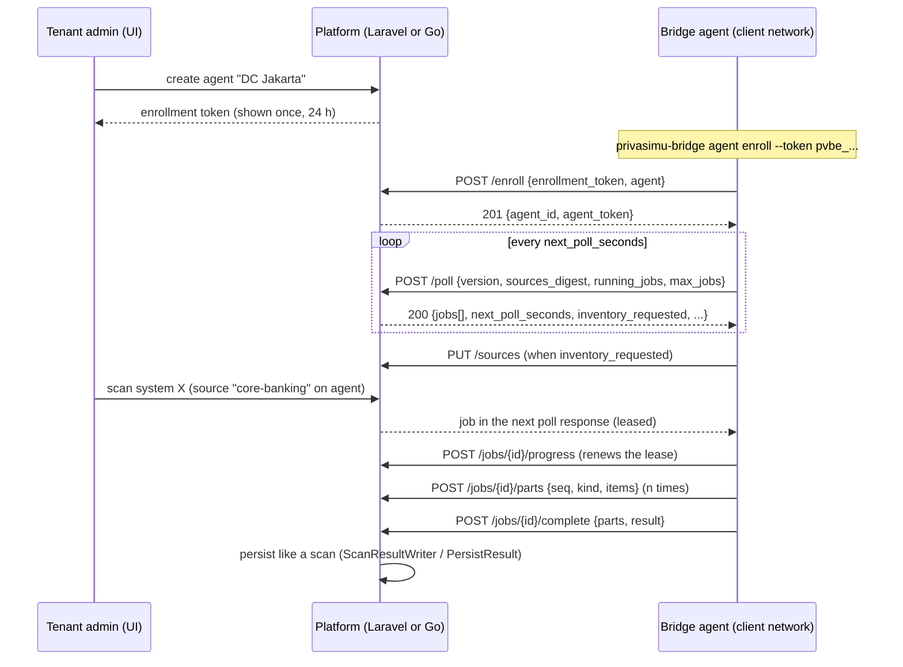

# Agent protocol 1 (mode B): platform contract

Status: **normative, revision 3 (2 November 2026)**; revision 4 (further database engines)
and revision 5 (job deadlines, where a job stopped, progress semantics, schemas per source;
6 November 2026) are **proposals** the agent already follows (section 13). The agent side is implemented and
tested in this repository (`internal/agent`, against an in-memory platform that follows
this document, `internal/agent/fakeplatform_test.go`). Both Privasimu Nexus lines implement
the platform side (branch `feat/bridge-agent-mode-b-2026-10-31` in each backend); revision 2
records what they settled after the Laravel line ran the real binary end to end, revision 3
adds package scans for the security posture per RoPA ("DSPM", phase 1): the platform
feature list, the inventory kind and part kind `packages`, the job `scan_packages` and its
failure codes (section 13). Every revision 3 addition is negotiated in both directions, so
an agent and a platform of different revisions keep working together.

This document is the single contract for **both platform lines**: the Laravel backend
(`backend`, repositories priva-back and api-privasimu-nexus) and the Go backend
(`backend-go`, go-api-privasimu-nexus), and for both frontends. The two backends must
produce **byte-identical** responses for the same state: same routes, statuses, JSON keys
and key order, error codes and messages. The rules in section 2 make that possible with
`json_encode` and `encoding/json`.

Machine-readable parts: [`agent-protocol/errors.json`](agent-protocol/errors.json) (every
error code, status and exact message). Both backends should load it in their tests.

Contents: 1 Model · 2 Wire conventions · 3 Authentication and tokens · 4 Check order ·
5 Agent API · 6 Jobs, leases and results · 7 Persisting results · 8 Tenant API ·
9 Data model · 10 Scheduler · 11 Limits · 12 Test plan · 13 Revisions and open items.

## 1. Model



The agent never listens on a port. It names what it may scan (its **inventory**: database
sources, file roots and, since revision 3, packages targets from its local configuration,
by id, without hosts, paths or credentials). The platform creates **jobs** that name an inventory id; it can never send
a host, a path, a credential, a query or anything that widens what the local
configuration allows.

## 2. Wire conventions

- Base path: `{platform_url}/api/bridge-agent/v1`. The agent's `platform_url` has no
  trailing slash and no path in the default deployments; a path prefix is allowed.
- Transport: HTTPS only (TLS 1.2+). No redirects: a 3xx is an error for the agent.
- Every request from the agent carries:
  `Content-Type: application/json`, `Accept: application/json`,
  `User-Agent: privasimu-bridge/<version>`, `X-Bridge-Protocol: 1`, and except for
  `/enroll`, `Authorization: Bearer <agent_token>`. Job routes also carry
  `X-Lease-Token: <lease_token>`.
- Every platform response carries `Content-Type: application/json`,
  `Cache-Control: no-store, private` and `X-Bridge-Protocol: 1`; 429 and 503 carry
  `Retry-After: <integer seconds>`. Other headers (Date, Server, rate-limit headers) may
  differ between the lines; the agent ignores them.

**Canonical JSON** (every platform response body):

| Rule | Laravel | Go |
|---|---|---|
| Compact, no whitespace, no trailing newline | `json_encode` default | `Encoder.Encode` then trim the `\n` |
| Keys in the order this document lists them | ordered PHP arrays | struct field order (never `map` for objects) |
| `/` not escaped; non-ASCII as raw UTF-8 | `JSON_UNESCAPED_SLASHES \| JSON_UNESCAPED_UNICODE` | default |
| `<`, `>`, `&` not escaped | default | `Encoder.SetEscapeHTML(false)` |
| U+2028 and U+2029 escaped as `
`, `
` | default (without `JSON_UNESCAPED_LINE_TERMINATORS`) | default |
| Control characters: `\b \f \n \r \t`, others `\u00xx` (lower-case hex) | default | default (Go 1.22+) |
| Invalid UTF-8 replaced by U+FFFD | `JSON_INVALID_UTF8_SUBSTITUTE` | default |
| Empty object is `{}`, never `[]` (e.g. `options`, and the count maps of a stored file result: `totals`, `skipped`, `extensions`, a file's `categories`) | `new \stdClass` / `(object) []`; an `array` cast decodes a stored `{}` to `[]`, so restore the maps when encoding | struct or empty map |
| Empty list is `[]`, never `null` | `[]` | initialise slices |
| Integers only (no floats in platform responses) | `int` casts | `int` fields |
| Timestamps: UTC, seconds, literal `Z`: `2026-10-31T12:00:00Z` | `->utc()->format('Y-m-d\TH:i:s\Z')` | `t.UTC().Format("2006-01-02T15:04:05Z")` |
| UUIDs lower-case with hyphens | `Str::uuid()->toString()` | `uuid.NewString()` |
| Every documented key is present; a missing value is `null` | | pointer fields without `omitempty` |

Exception: `options` of a job lists only the options that were set (section 6.2).

Laravel keeps empty count maps as `{}` through `ScanResultsCast` (the `scan_results`
column) and `AgentResults::jsonMaps`; Go keeps them as decoded. Frontends still read every
count map with `Object.entries(x ?? {})`, so `{}`, `[]` and `null` all render as empty.

The tenant API of section 8 uses the same flags (`/` and non-ASCII unescaped).

**Errors** always use the envelope
`{"error":{"code":"<code>","message":"<message>"}}` with the status and the exact English
message of [`errors.json`](agent-protocol/errors.json):

| Code | Status | Message |
|---|---|---|
| `invalid_request` | 400 | The request is not valid. |
| `unauthenticated` | 401 | The agent token is missing or not valid. |
| `agent_revoked` | 401 | This agent has been revoked. |
| `enrollment_invalid` | 401 | The enrollment token is not valid, already used or expired. |
| `forbidden` | 403 | This agent may not perform this action. |
| `not_found` | 404 | Not found. |
| `job_not_found` | 404 | The job does not exist for this agent. |
| `method_not_allowed` | 405 | This method is not allowed here. |
| `lease_expired` | 409 | The job lease is not valid or has expired. |
| `part_conflict` | 409 | A different part with this number was already received. |
| `parts_incomplete` | 409 | Not every part of the result has been received. |
| `payload_too_large` | 413 | The request body is too large. |
| `unsupported_media_type` | 415 | The request body must be JSON. |
| `protocol_unsupported` | 426 | This agent protocol version is not supported; upgrade the bridge. |
| `rate_limited` | 429 | Too many requests; retry later. |
| `server_error` | 500 | Internal error. |
| `maintenance` | 503 | The service is temporarily unavailable; retry later. |

Example (exact bytes):
`{"error":{"code":"lease_expired","message":"The job lease is not valid or has expired."}}`.
No error carries field details, a stack trace, a tenant name or any submitted value.
Laravel must render these envelopes for 404/405/413/419/500 under the agent prefix
instead of the framework's default error pages (route-prefixed exception rendering): a
419 becomes `400 invalid_request` (errors.json has no 419 code), a body above
`post_max_size` `413 payload_too_large`, anything unexpected `500 server_error`. OPTIONS
and HEAD under the prefix get `405 method_not_allowed` with `Allow`, never a CORS answer.

## 3. Authentication and tokens

| Token | Format | Issued | Stored by the platform |
|---|---|---|---|
| Enrollment token | `pvbe_` + 43 chars of base64url (32 random bytes) | when the admin creates the agent (or renews the token) | SHA-256, lower-case hex, 64 chars |
| Agent token | `pvba_` + 43 chars base64url | on enroll and on rotate | SHA-256 hex (current and previous) |
| Lease token | `pvbl_` + 43 chars base64url | when a job is leased | SHA-256 hex |

- Tokens are random (CSPRNG). The platform returns a token in clear exactly once and
  stores only the hash; it looks a token up by its hash and compares hashes with a
  constant-time compare.
- Enrollment tokens expire after 24 hours and are single-use.
- Agent token lookup is cross-tenant (the token identifies the tenant). In the Laravel
  line on PostgreSQL with RLS this lookup must run inside
  `CurrentOrgContext::lintasTenant()`; afterwards the middleware sets the organization
  context from the agent row, then applies `tenant.db` (BYODB) and `tenant.readonly`.
- Lookup: a token matches `token_hash`, or `previous_token_hash` while
  `previous_token_expires_at` is in the future; the status is checked right after the
  lookup. An agent with status `revoked` gets `401 agent_revoked`; a `pending` agent (not
  enrolled), an unknown or expired token, or an agent whose organisation row no longer
  exists gets `401 unauthenticated` (on `/enroll` the last case is `401 enrollment_invalid`).
- Right after authentication (for `/enroll` right after the token lookup) the
  organisation must be active: an archived, deleted or frozen organisation gets
  `403 forbidden` on every route.
- **Revocation keeps `token_hash` and `previous_token_hash`**, so a revoked agent hears
  `agent_revoked` (and stops) instead of `unauthenticated`. It clears
  `enrollment_token_hash`, `enrollment_expires_at` and `rotation_requested`, sets
  `revoked_at`, and fails the agent's `queued` and `leased` jobs with `error_code`
  `agent_revoked` and `error_kind` `platform`, clearing their lease hashes (their parts
  are deleted). Revoking an agent twice changes nothing.
- Rotation: the new token is valid at once; the previous one stays valid for 600 seconds
  (`previous_valid_seconds`). **While a request authenticates with the previous token,
  `/poll` answers `token_rotation_requested: true`**: the agent lost the answer of its last
  rotation and rotates again (section 5.8). Without this, an agent whose answer was lost
  would keep the old token after the flag was cleared and be locked out after 600 s.

## 4. Check order

Both backends check in this order and answer with the first failure:

1. Route and method: `404 not_found`, `405 method_not_allowed` (with `Allow`; also for
   OPTIONS and HEAD).
2. `X-Bridge-Protocol` must be exactly `1`: else `426 protocol_unsupported`.
3. Body size (`Content-Length` or the bytes read): parts 1 048 576 bytes, every other route
   65 536 bytes: else `413 payload_too_large`.
4. `Content-Type` must be `application/json` (parameters such as `charset` allowed): else
   `415 unsupported_media_type`.
5. Authentication (not for `/enroll`): `401 unauthenticated` / `401 agent_revoked`; then
   the organisation check of section 3: `403 forbidden`.
6. Rate limit (section 11): `429 rate_limited` with `Retry-After`.
7. Tenant in migration (`tenant.readonly`: freezing or migrating): `503 maintenance` with
   `Retry-After: 60`. For `/enroll` this check runs after step 9's token lookup.
8. Body: one JSON object (not an array, not empty), field rules of section 5:
   `400 invalid_request`. Unknown keys are ignored.
9. Resource checks (job ownership, lease, state): codes of section 6.

## 5. Agent API

Field rules use these definitions:

- *label* = 1 to 128 characters and *text* = 0 to 512 characters. Both count Unicode
  characters (code points, not bytes), must be valid UTF-8 and may not contain a C0
  control character (U+0000 to U+001F) or DEL (U+007F). **C1 characters (U+0080 to U+009F)
  are allowed.** This is exactly the bridge's own configuration check; Laravel
  (`AgentProtocol::text`) and Go (`isText`) apply the same rule.
- *id* = `^[a-z0-9][a-z0-9_.-]{0,62}$`; *digest* = `^sha256:[0-9a-f]{64}$`; *uuid* =
  lower-case UUID; *word* = `^[a-z0-9_]{1,40}$`.
- A list is a JSON array, `[]` when empty; `null` in place of a list is `400`.

### 5.1 `POST /enroll`

No `Authorization`. Rate limit per client IP.

Request:
```json
{"enrollment_token":"pvbe_…","agent":{"version":"0.1.0","protocol":1,"os":"linux","arch":"amd64","capabilities":["job:test_source","job:scan_database","job:scan_files","engine:postgresql","engine:mysql","engine:mssql","engine:oracle","engine:mongodb","files:txt,csv,json,docx,xlsx,pdf"]}}
```
Rules: `enrollment_token` matches `^pvbe_[A-Za-z0-9_-]{43}$` (else `401
enrollment_invalid`, not 400, so the format reveals nothing); `agent.protocol` must be 1
(else `426 protocol_unsupported`); `version` 1 to 40 printable ASCII; `os`, `arch` *word*
(stored cut to 20 characters); `capabilities` a list of at most 64 strings of 1 to 64
characters `^[a-z0-9_:,.-]+$`. The bridge keeps its `version` within this rule even when a
build sets another one.

Effect: the agent (status `pending`, token not expired) becomes `active`; the enrollment
hash is cleared; `enrolled_at`, `version`, `protocol`, `os`, `arch`, `capabilities` and
`last_seen_at` are stored; an agent token is issued. Audit: `bridge_agent.enrolled`.

Response `201`:
```json
{"agent_id":"9b2f6c1e-0000-4000-8000-000000000001","agent_token":"pvba_…","organization":{"name":"PT Contoh"},"poll_interval_seconds":15}
```
Errors: `401 enrollment_invalid` (unknown, used, expired, or the agent is not `pending`),
`426`, `429`, `503`.

### 5.2 `POST /poll`

The heartbeat and the request for work. Rate limit per agent (section 11).

Request:
```json
{"version":"0.1.0","protocol":1,"os":"linux","arch":"amd64","capabilities":["job:test_source"],"sources_digest":"sha256:5f…","running_jobs":["3d5c…"],"max_jobs":1}
```
Rules: as enroll for the agent fields; `sources_digest` is `""` or a *digest*;
`running_jobs` at most 50 *uuid*; `max_jobs` 0 to 10.

`capabilities` holds `job:<type>` for every job type the agent's `agent.allowed_jobs`
allows. `job:scan_packages` appears **only** when the operator added `scan_packages` to
`allowed_jobs` (opt-in, never a default). The platform stores the list on every poll.

Effect: update `last_seen_at` (at most one write per 30 seconds is enough), `version`,
`protocol`, `os`, `arch`, `capabilities`, `last_ip`. Then expire this agent's leases
(section 6.1) and lease up to `min(max_jobs, 4)` jobs of this agent in state `queued`,
oldest `queued_at` first (ties by `id`), each as in section 6.1.

Response `200` (key order as shown):
```json
{"jobs":[{"job_id":"3d5c6e70-1111-4000-8000-000000000002","type":"scan_database","source_id":"core-banking","lease_token":"pvbl_…","lease_seconds":120,"attempt":1,"created_at":"2026-10-31T12:00:00Z","options":{"max_tables":500}}],"next_poll_seconds":5,"inventory_requested":false,"token_rotation_requested":false,"server_time":"2026-10-31T12:00:05Z","platform_features":["source_kind:packages","job:scan_packages"]}
```
- `jobs`: `[]` when none.
- `next_poll_seconds`: 5 when this agent still has `queued` jobs after leasing, else 15.
- `inventory_requested`: true when the stored digest is null or differs from the request.
- `token_rotation_requested`: true when an admin asked to rotate (section 8) **or** when
  this request was authenticated with the previous token (the answer of the agent's last
  rotation was lost, section 3). The agent rotates whenever it is true.
- `platform_features` (revision 3, always the last key): what the platform supports beyond
  revision 2. Both lines emit exactly `["source_kind:packages","job:scan_packages"]`, in this
  order, once they ship revision 3. A platform of revision 2 sends no such key; the agent
  treats a missing key like `[]` and ignores unknown entries (unknown keys of an answer are
  ignored, section 4).

**Negotiation (revision 3).** Both directions are opt-in:

| Direction | Signal | Effect |
|---|---|---|
| agent → platform | `job:scan_packages` in `capabilities` (only when `scan_packages` is in `agent.allowed_jobs`) | the platform may queue `scan_packages` for this agent; for any other agent the tenant action answers `409 AGENT_CAPABILITY_MISSING` (section 8) |
| platform → agent | `source_kind:packages` in `platform_features` | the agent includes inventory entries of kind `packages` in `PUT /sources` (section 5.3) |

The agent decides from the **last** poll answer: when `source_kind:packages` appears, it
sends its inventory again at once (now with the packages targets, so the digest changes);
when a platform stops listing it (a downgrade), the agent sends the inventory without them.
A revision 2 platform refuses a whole inventory with an unknown kind, which is why the agent
never sends kind `packages` before the platform asked for it.

**Further engines (revision 4, proposal).** The same rule covers database engines beyond
the five of revision 2: a platform that accepts one lists `source_engine:<engine>`
(`source_engine:redshift`, `source_engine:snowflake`, ..., section 13); the agent includes `database`
entries of that engine only when the last poll answer lists it, resends its inventory when
the list changes, and logs once per source that a source is withheld. A platform that lists
none (revision 2 or 3) never receives such an entry.

The agent asks for `max_jobs` of at most 10 and waits `next_poll_seconds` between polls,
within its configured `poll_min` (at least 1 s) and `poll_max` (at most 5 minutes, so a
lost rotation answer is retried inside the 600 seconds).

### 5.3 `PUT /sources`

Replaces the agent's inventory.

Request:
```json
{"sources_digest":"sha256:5f…","sources":[{"id":"core-banking","kind":"database","engine":"postgresql","label":"Core banking","description":"DC Jakarta","capabilities":["sampling"]},{"id":"hr-share","kind":"files","engine":"filesystem","label":"HR share","capabilities":["path_mode:hashed","content_scan"]}]}
```
Rules: `sources_digest` *digest*; `sources` a list (`[]` when the agent offers nothing,
never `null`) of at most 200 objects with unique *id*; `kind` `database` (engine
`postgresql`, `mysql`, `mssql`, `oracle`, `mongodb`, and with revision 4 any engine the
platform listed as `source_engine:<engine>`), `files` (engine `filesystem`) or,
since revision 3, `packages` (engine `host`, `directory` or `image_archive`);
`label` *label* (required: one invalid entry refuses the whole inventory); `description`
absent, `null` or *text* (an empty string is stored as `null`); `capabilities` a list of
at most 16 strings `^[a-z0-9_:,.-]{1,64}$`.

**Kind `packages`** (revision 3) names a system whose installed software the agent may list
(job `scan_packages`): `host` an installed system (normally its root `/`), `directory` one
application or deployment folder, `image_archive` a container image saved as a local OCI or
`docker save` archive file (no Docker socket and no registry pull in phase 1). Its
`capabilities` are `matcher:grype`, `matcher:trivy` or `matcher:none` (always one), then
`os:<id>` when the agent knows the operating system (`os-release` `ID` of a host, or the
last scan), for example `["matcher:grype","os:ubuntu"]`. The agent sends kind `packages`
only after a poll answer listed `source_kind:packages` (section 5.2). Such entries are never
offered to Data Discovery: linking an information system to one is refused with the
existing `BRIDGE_SOURCE_MISMATCH` (section 8).

```json
{"id":"web-01","kind":"packages","engine":"host","label":"Web 01","capabilities":["matcher:grype","os:ubuntu"]}
```

The bridge sends the id as the label when its configuration has none, and its
configuration check refuses more than 200 sources and file roots together, so an
inventory it sends is always accepted.

**Schemas per source (revision 5, proposal; contract P-4).** A `database` entry may carry
`schemas` after `capabilities`: the schema names the source's account can see, so that the
platform can offer a choice per source (job option `schemas`, section 6.2).
```json
{"id":"ora-free","kind":"database","engine":"oracle","label":"Oracle FREEPDB1","capabilities":["sampling"],"schemas":["HR","SALES"]}
```
- The names, sorted by byte and unique: for Oracle the owners of at least one table the
  account can read, without Oracle-maintained accounts; PostgreSQL and Redshift the schemas
  with `USAGE`; MySQL and MariaDB the databases; SQL Server the user schemas. Narrowed by
  the source's local `schemas` allow-list (compared without case, in the database's
  spelling); before the database was read, a source with an allow-list offers the
  allow-list itself.
- Absent: no list is known (MongoDB, ClickHouse and the cloud warehouses report none yet,
  or the database was not read): the platform offers no choice. `[]`: read, and the
  account sees no schema.
- Rule: at most 200 names of 1 to 128 characters each (the *label* rule), and at most
  32 768 bytes of names in the whole inventory. The agent cuts a list to fit, in inventory
  order, and then adds the capability `schemas_partial` to the entry. A platform that reads
  the key refuses anything else with `400 invalid_request`; on an entry of another kind it
  ignores the key.
- The agent reads the lists in the background when it starts (one source at a time), and
  again after every successful `test_source` and `scan_database` of a source; it keeps them
  in its state directory between restarts. A changed list changes the digest, so the next
  poll answer asks for the inventory.

The digest is computed by the agent (SHA-256 of its JSON inventory) over exactly the
entries it sends; the platform stores it and never recomputes it. When packages entries
start (or stop) being sent, the digest changes, so the platform also asks for the
inventory (`inventory_requested`) if the agent's immediate resend was lost.

Effect: upsert by (`agent_id`, `id`); delete the ids not listed (systems linked to a
deleted id show "source not on agent" and cannot be scanned); store the digest. The
inventory id becomes the tenant `Source.id` (section 8).

Response `200`: `{"accepted":2}`.

### 5.4 `POST /jobs/{job_id}/progress`

Header `X-Lease-Token`. Renews the lease.

Request: `{"progress":42,"stage":"tables","done":120,"total":300}` — `progress` 0 to 100,
`stage` *word*, `done` and `total` 0 to 1 000 000 000.

Effect: store progress and stage (`information_systems.scanning_progress` follows
`progress`); `lease_expires_at = now + lease_seconds`.

Response `200`: `{"lease_seconds":120,"cancel_requested":false}`. When an admin cancelled
the job, `cancel_requested` is true; the agent stops and sends `fail` with
`error_code: "canceled"`.

**Heartbeat and progress (revision 5).** This route is both the lease renewal and the
progress report. The agent sends it every `lease_seconds / 3` (40 seconds) while a job runs.
Its four values change only when the job advanced; a renewal while nothing advanced repeats
the previous values exactly and is a heartbeat, never progress:

| `stage` | Job types | `done` / `total` |
|---|---|---|
| `starting`, `connect`, `list_tables` | test_source, scan_database | 0 / 0 |
| `tables` | scan_database | tables finished / tables listed |
| `files` | scan_files | files seen in this walk / files the root's previous scan saw (0 when unknown) |
| `waiting`, `inventory`, `matching` | scan_packages | 0 / 0 |
| `upload` | every job with parts | parts sent / parts to send |

Stages only move forward in this order; `done` never decreases within a stage, and
`progress` (`done` × 100 / `total`, at most 99, 0 while `total` is 0) never decreases within
an attempt. A platform that detects stalls (contract P-3) compares all four values with the
previous renewal under the same lease, not the percentage alone: one per cent of 500 tables,
or a file walk whose total is unknown, can take longer than its stall limit while every
table or file is real advancement. Stages without counts are bounded by the agent itself
(statement timeouts, tool timeouts, the job deadline of section 6.8).

### 5.5 `POST /jobs/{job_id}/parts`

Header `X-Lease-Token`. Uploads one slice of the result. Body at most 1 MiB.

Request: `{"seq":0,"kind":"tables","items":[…]}` — `seq` 0 to 499; `kind` `tables` for
`scan_database`, `files` for `scan_files`, `packages` for `scan_packages` (revision 3;
else 400); `items` 1 to 1000 objects (sections 6.4, 6.5 and 6.7). The agent sends at most
200 items and 512 KiB of items per part.

Effect: store the raw request body and its SHA-256 under (`job_id`, `seq`); renew the
lease. The same `seq` again with an identical body (same SHA-256) is accepted again
(idempotent); with a different body it is `409 part_conflict`.

Response `200`: `{"seq":0,"received":true}`.

### 5.6 `POST /jobs/{job_id}/complete`

Header `X-Lease-Token`.

Request: `{"parts":3,"result":{…}}` — `parts` 0 to 500; `result` per job type
(section 6.3 to 6.5).

Checks: parts `0 … parts-1` received and none with `seq ≥ parts`, else
`409 parts_incomplete`; `result` valid for the job type, else `400 invalid_request`.

Effect: persist (section 7), job `completed`, `finished_at`, parts deleted. Parts are
persisted **as a stream**: one stored part is decoded, applied and released before the next
(a `scan_packages` job may carry 20 000 items; neither line decodes every part at once).

Response `200`: `{"status":"completed"}`. A repeated `complete` for a job already
`completed` under the same lease returns the same `200` (the first response may have
been lost).

### 5.7 `POST /jobs/{job_id}/fail`

Header `X-Lease-Token`.

Request: `{"error_kind":"auth","error_code":"database_auth","retryable":false,"stage":"connect"}`
— each *word* (`error_code` up to 60 characters). There is never a free-text message:
driver messages can quote values or internal names, so the agent only sends codes.

Revision 5 adds an optional key `table`, after `stage`, when a database scan stopped at a
table (its deadline, a cancellation, the watchdog of section 6.8):
`{"error_kind":"timeout","error_code":"timeout","retryable":true,"stage":"sampling","table":"HR.EMPLOYEES"}`.
It is `schema.table` (the table alone for an engine without schemas), 1 to 255 bytes of
valid UTF-8 without a C0 control character or DEL (the name rule of section 6.4): a name,
never a value. `stage` is then the step that table was in: `columns`, `sampling`,
`detection` (values being classified), `entities` (the local language model) or `access`
(section 13, revision 4). Platforms of earlier revisions ignore the key (section 4, step 8).

Effect: if `retryable` is true, `error_code` is not `canceled` and `attempt < 2`, the job
goes back to `queued`; otherwise it is `failed` and the system records the failure with
the text of section 6.6.

Response `200`: `{"status":"failed"}` (also when re-queued, and again for a repeated
`fail` under the same lease).

### 5.8 `POST /token/rotate`

Request: `{}`. Response `200`:
`{"agent_token":"pvba_…","previous_valid_seconds":600}`. Effect: previous hash = current
hash (also when this request was authenticated with the previous token),
`previous_token_expires_at = now + 600 s`, current = new hash, rotation flag cleared.
Audit: `bridge_agent.token_rotated`.

A lost answer: the platform has rotated, the agent still holds the token that is now the
previous one. Its next poll is answered with `token_rotation_requested: true` (section 3)
and it rotates again with that token. The agent uses a new token at once and, if it cannot
store it, stores it again after every poll.

Known limit (open item, section 13): when the second answer is lost too, the second
rotation makes the never-delivered token the previous one, so the token the agent holds
stops working at once and the agent must be enrolled again.

### 5.9 Job route checks

For every `/jobs/{job_id}/…` route, after section 4: `job_id` not a lower-case UUID, or a
job of another agent or tenant: `404 job_not_found` (existence is never revealed).
`X-Lease-Token` missing, not matching the current lease, lease expired, or the job not
`leased`: `409 lease_expired` (except the repeated complete/fail of 5.6/5.7).

## 6. Jobs, leases and results

### 6.1 Leasing

When a job is leased: `status = leased`, `attempt = attempt + 1`, a new lease token,
`lease_seconds = 120`, `lease_expires_at = now + 120 s`, `leased_at = now`. A lease that
expires (no progress, part or result for 120 s) makes the job `queued` again when
`attempt < 2` (progress and stage reset, parts deleted), otherwise `failed` with
`error_code = agent_timeout`. The job may then be leased to the same agent while its old
run is still going (after an outage longer than the lease): the bridge recognises the job
id with a new lease token, stops the old run without reporting, and runs the job again
under the new lease.

States: `queued → leased → completed | failed`; `leased → queued` (expired or retryable
fail); `queued | leased → canceled` (admin); `failed` with `agent_revoked` when the agent
is revoked while it holds jobs.

### 6.2 Job types and options

| `type` | `source_id` names | Options the platform may set |
|---|---|---|
| `test_source` | a database source or a file root | none |
| `scan_database` | a database source | `schema`, `schemas` (revision 5), `max_tables` (≤ 500), `max_columns` (≤ 1000), `sampling` (only `false` has an effect), `deadline_seconds` |
| `scan_files` | a file root | `refresh`, `max_age_seconds`, `deadline_seconds` |
| `scan_packages` (revision 3) | a packages target | `refresh`, `max_age_seconds`, `deadline_seconds` (≤ 3600), `match` |

`options` lists only the keys that were set, in this order: `schema`, `schemas`,
`max_tables`, `max_columns`, `sampling`, `deadline_seconds`, `refresh`, `max_age_seconds`,
`match`; `{}` when none. Options can only narrow what the agent's local configuration
allows: the platform can lower limits, narrow to allowed schemas or switch sampling off,
never on.

`schemas` (revision 5, proposal; contract P-4): a list of 1 to 100 names (each 1 to 128
characters, the *label* rule) chosen from the source's inventory `schemas` (section 5.3).
The platform sends it when the system's `connection_config.bridge_schemas` is a non-empty
array and the linked source reports `schemas` (an agent that reports them understands the
option); it never sends `schema` together with it. The agent scans exactly those schemas;
table names stay as without options (bare in the connection's default schema,
`schema.table` otherwise). A name outside the source's local allow-list, a name outside
the rule, or the option for an engine without schemas (MongoDB) fails the job with
`error_kind` `config`, `error_code` `invalid_options`, stage `accept`; a name the database
no longer has yields no tables. An agent of an earlier revision ignores the option.

`scan_packages` options: `refresh` (bool) scans now; otherwise the agent answers with its
stored report of the target when it is younger than `max_age_seconds` (default 24 hours),
like `scan_files`. The agent also rescans a target in the background on its local
`refresh_interval`. `deadline_seconds` (at most 3600) lowers the agent's configured scan
timeout. `match` (bool, default true) runs the configured matcher; `false` sends the
inventory only (every item's `matches` is `[]` and the result's `matcher` is `none`). The
platform queues `scan_packages` only for agents whose stored `capabilities` contain
`job:scan_packages`; an agent that receives it without allowing it fails it with
`job_not_allowed`.

### 6.3 Result of `test_source` (no parts)

The shape of the existing connection-test response:
```json
{"success":true,"latency_ms":35,"server_version":"PostgreSQL 16.4","tables_found":120,"ssl_enabled":true}
```
`server_version` (at most 30 characters), `tables_found` and `ssl_enabled` may be `null`
(a file root has no tables).

### 6.4 Result of `scan_database` (parts of kind `tables`)

Result:
```json
{"engine":"postgresql","server_version":"PostgreSQL 16.4","ssl_enabled":true,"tables_total":451,"tables_failed":[{"name":"audit.log","error_kind":"permission"}],"truncated":true,"sampling":true,"duration_ms":8123,"bridge_version":"0.1.0"}
```
`truncated` means that not every table was analysed (the table limit, or names that
cannot be stored).

Each item of a `tables` part:
```json
{"name":"users","schema":"public","row_estimate":1200,"omitted_columns":0,"sampled":true,"columns":[{"name":"kontak","data_type":"character varying(255)","nullable":true,"pii":true,"category":"phone","pdp_category":"umum","confidence":1,"detection":"content","shadow":true,"protection_state":"plaintext","content":{"sampled":20,"matching":20,"matches":{"phone":20}}}]}
```
- `name` is the table as reported (`schema.table` outside the default schema); every
  name is 1 to 255 bytes of valid UTF-8 without a C0 control character or DEL (the
  *label* rule's characters).
- `row_estimate` may be null; `sampling_error` (a dbsource kind) appears when sampling
  failed and the columns were classified by name only.
- Column: `category` and `pdp_category` are absent when `pii` is false; `detection` is
  `none`, `name`, `content` or `name+content`; `content` and `protection_state` appear
  only when values were sampled. `confidence` is 0 to 1 with at most two decimals.

There is never a value, a sample or a row in a part.

### 6.5 Result of `scan_files` (parts of kind `files`)

Result (the root summary):
```json
{"root_id":"hr-share","label":"HR share","content_scan":true,"path_mode":"hashed","scanned_at":"2026-10-31T13:53:10.147Z","duration_ms":812,"files_seen":10234,"files_scanned":9800,"files_with_pii":420,"totals":{"nik":1520,"email":800},"skipped":{"unsupported":400,"link":3},"extensions":{".pdf":1200,".xlsx":800},"truncated":false}
```
Each item of a `files` part:
```json
{"id":"f_2207cae0c743e650","ext":".csv","size_bytes":49,"modified":"2026-10-31","categories":{"nik":1,"phone":1},"pdp_category":"spesifik"}
```
`path` appears only when the root is configured with `report_paths: relative`;
otherwise `id` (a keyed hash the bridge can map back to the path locally) is the only
name. `name_hint` (a category suggested by the file name) and `truncated` are optional.
No file content ever appears.

### 6.6 Failure codes and the text shown to users

`fail.error_code` values and the Indonesian text both backends store as the scan error
(the frontend may translate by code):

| `error_code` | Text |
|---|---|
| `database_auth` | Basis data menolak login bridge. Periksa akun di konfigurasi bridge. |
| `database_permission` | Akun basis data bridge tidak punya izin yang diperlukan. |
| `database_not_found` | Basis data atau service tidak ditemukan. |
| `database_unreachable` | Bridge tidak dapat menjangkau basis data. |
| `database_timeout` | Basis data tidak menjawab tepat waktu. |
| `database_tls` | Koneksi TLS ke basis data gagal. |
| `database_blocked` | Alamat basis data tidak diizinkan di bridge. |
| `database_config`, `secret_missing` | Konfigurasi sumber di bridge tidak lengkap. |
| `database_unsupported` | Jenis basis data ini tidak didukung bridge. |
| `database_error` | Basis data mengembalikan galat. |
| `source_not_found` | Sumber ini tidak ada di konfigurasi bridge. |
| `file_root_missing` | Root berkas ini tidak ada atau tidak dapat dipakai di bridge. |
| `file_root_error` | Bridge tidak dapat membaca root berkas ini. |
| `scan_running` | Pemindaian root berkas ini masih berjalan di bridge. |
| `unsupported_job`, `job_not_allowed` | Bridge tidak menerima jenis tugas ini. |
| `invalid_options` | Opsi tugas ditolak bridge. |
| `result_too_large` | Hasil pemindaian terlalu besar untuk dikirim. |
| `timeout` | Pemindaian melebihi batas waktu. |
| `canceled` | Pemindaian dibatalkan. |
| `internal_error` | Galat internal di bridge. |
| `agent_timeout` (platform) | Bridge tidak menyelesaikan tugas tepat waktu. |
| `agent_revoked` (platform) | Agen bridge sudah dicabut. |
| `tool_missing` | Alat pindai paket (Syft/Grype/Trivy) belum terpasang di server agen. |
| `tool_checksum_mismatch` | Berkas alat pindai paket tidak cocok dengan checksum di konfigurasi agen. |
| `tool_failed` | Alat pindai paket gagal dijalankan. |
| `tool_timeout` | Pindai paket melewati batas waktu. |
| `matcher_db_unavailable` | Basis data kerentanan di agen belum tersedia atau kedaluwarsa. |
| `target_unreadable` | Agen tidak dapat membaca target pindai paket. |
| any other code | Pemindaian lewat bridge gagal. |

The six package codes (revision 3) come with this `error_kind` and `retryable`:

| `error_code` | `error_kind` | `retryable` | When |
|---|---|---|---|
| `tool_missing` | `config` | false | Syft or the configured matcher is not at its configured path, or is not a regular file |
| `tool_checksum_mismatch` | `config` | false | the tool's SHA-256 differs from the configuration (checked before every run) |
| `tool_failed` | `internal` | true | a tool exited with an error, wrote more than 256 MiB, or wrote output that is not its documented JSON |
| `tool_timeout` | `timeout` | true | the scan passed its timeout (configuration, lowered by `deadline_seconds`) |
| `matcher_db_unavailable` | `config` | false | the matcher has no local vulnerability database, or it is older than allowed, and may not download one |
| `target_unreadable` | `permission` | false | the target is missing, not a directory (host, directory), or not an OCI or docker image archive |

`stage` of a package failure is one of `target`, `tool`, `inventory`, `matching`, `output`,
`run`. A source id that names no packages target is `source_not_found`, as for the other
job types.

`error_kind` is stored next to the text as the platform's `error_kind`; failures the
platform makes itself (`agent_timeout`, `agent_revoked`) have `error_kind` `platform`.
A `timeout` or `canceled` of a database scan may carry `table` (revision 5, section 5.7);
the platform stores it with the failure and shows it with the text and the stage.

### 6.7 Result of `scan_packages` (parts of kind `packages`, revision 3)

The agent runs Syft for the inventory and Grype or Trivy for the matches, as child
processes on the agent's server (section 6.7.1). Each item of a `packages` part is one
package (keys in this order):
```json
{"name":"openssl","version":"3.0.13-0ubuntu3.4","ecosystem":"Ubuntu","ecosystem_release":"24.04","purl":"pkg:deb/ubuntu/openssl@3.0.13-0ubuntu3.4?arch=amd64&distro=ubuntu-24.04","type":"os_package","layer":"os","dependency":"unknown","licenses":["Apache-2.0"],"matches":[{"id":"CVE-2024-5535","aliases":[],"severity":"medium","cvss":[{"version":"3.1","vector":"CVSS:3.1/AV:N/AC:L/PR:N/UI:N/S:U/C:H/I:N/A:H","score_tenths":91}],"fix_versions":["3.0.13-0ubuntu3.5"],"matcher":"grype"}]}
```

| Key | Rule |
|---|---|
| `name` | 1 to 255 characters (*label* characters). In the form the ecosystem's advisories use: Maven `groupId:artifactId`, npm `@scope/name`, Packagist `vendor/name`, Go the module path, otherwise as reported. The platform normalises case (contract 8.2). |
| `version` | 1 to 128 characters, as reported |
| `ecosystem` | `npm`, `Packagist`, `Go`, `Maven`, `PyPI`, `NuGet`, `RubyGems`, `crates.io`, `Debian`, `Ubuntu`, `Alpine`, `Red Hat`, `Rocky Linux`, `AlmaLinux`, `other` |
| `ecosystem_release` | absent, or 1 to 32 characters: the distribution release of an OS package (`24.04`, `12`, `3.20.3`, `9.4`) |
| `purl` | absent, or 1 to 512 characters |
| `type` | `library`, `os_package`, `application`, `framework`, `container`, `firmware`, `other` |
| `layer` | `os` (OS packages), `runtime` (frameworks, platforms and language runtimes such as node, php, python, openjdk), `application` |
| `dependency` | `direct`, `transitive`, `unknown` (phase 1 agents send `unknown`) |
| `licenses` | at most 10 strings of 1 to 64 characters (SPDX id, name or expression); `[]` when none |
| `matches` | at most 200; `[]` when none or when the job had `match: false` |
| match `id` | `^[A-Za-z0-9._:-]{3,64}$` (CVE, GHSA, distribution advisory, ...) |
| match `aliases` | at most 20 ids of the same pattern, without `id` itself |
| match `severity` | `critical`, `high`, `medium`, `low`, `negligible`, `unknown` |
| match `cvss` | at most 8 entries `{"version","vector","score_tenths"}`: `version` `d.d` (`2.0`, `3.0`, `3.1`, `4.0`), `vector` 1 to 200 printable ASCII characters, `score_tenths` an **integer** 0 to 100 (the base score × 10; no floats on the wire) |
| match `fix_versions` | at most 10 strings of 1 to 128 characters |
| match `matcher` | `grype` or `trivy` |

The agent sends every key except `ecosystem_release` and `purl`, which it leaves out when
unknown. The platforms treat a wrong-typed field as absent (clarification C precedent) and
skip and count an item without a valid `name`, `version` or `ecosystem`. One package is one
item: copies found in several places (two `node_modules` folders) are merged by
(`ecosystem`, `name`, `version`), and their matches by `id`. Items with matches come first;
an agent never sends more than 20 000 items per job, and no more than fit into 500 parts.

Result (`complete.result`, at most 64 KiB, keys in this order):
```json
{"target_kind":"host","target_label":"Web 01","os":{"id":"ubuntu","version":"24.04"},"inventory_tool":"syft","inventory_tool_version":"1.55.0","matcher":"grype","matcher_version":"0.121.0","matcher_db_built_at":"2026-11-01T04:12:30Z","packages_total":1834,"matches_total":42,"truncated":false,"duration_ms":91234,"bridge_version":"0.3.0","sbom_sha256":"<64 hex>"}
```
- `target_kind` the target's kind; `target_label` its label.
- `os` `{"id","version"}` of the scanned system or image, or `null`.
- `inventory_tool` is `syft`; `inventory_tool_version` its version (`unknown` when Syft did
  not report one).
- `matcher` `grype`, `trivy` or `none`; with `none`, `matcher_version` and
  `matcher_db_built_at` are `null`. Otherwise `matcher_version` is the version
  (`unknown` when not reported) and `matcher_db_built_at` the build time of the matcher's
  vulnerability database (UTC, `Z`), or `null` when the matcher did not report one.
- `packages_total` distinct packages found; `matches_total` matches in the items sent.
- `truncated` true when not everything found was sent: more packages than 20 000 (or the
  agent's lower `max_packages`), more than fit into 500 parts, more than 200 matches for a
  package, or a package, match or match field outside the rules above.
- `sbom_sha256` the SHA-256 of the CycloneDX SBOM Syft produced (the SBOM itself never
  leaves the agent's server).

`bridge_jobs.result` keeps exactly these keys. The platform stores at most 20 000 items per
job; parts beyond are ignored and the job is stored with `truncated` true.

#### 6.7.1 How the agent scans (normative for the agent, informative for the platforms)

- Tools are executables the operator installs: Syft (inventory) and Grype or Trivy
  (matching). Each one is pinned by absolute path and SHA-256 in `packages.tools`; the
  agent verifies the checksum before every run and never downloads a tool.
- Child processes run without a shell and with fixed argument lists:
  `syft scan dir:<path> -o cyclonedx-json [--exclude ./<rel>/** …]` (host, directory),
  `syft scan oci-archive:<file> -o cyclonedx-json` or `docker-archive:<file>` (image
  archive), `grype sbom:<sbom> -o json`, `trivy sbom <sbom> --format json [--skip-db-update]`
  and `trivy version --format json`. Standard output goes to a private file capped at
  256 MiB; standard error is kept locally (last 64 KiB) only to tell a database problem
  from another failure, and is never sent.
- The environment is emptied: `HOME` and `TMPDIR` point below the agent's state directory,
  plus `SYFT_CHECK_FOR_APP_UPDATE=false` (and Syft's remote licence and Maven lookups
  switched off), `GRYPE_CHECK_FOR_APP_UPDATE=false`, `GRYPE_DB_CACHE_DIR`,
  `GRYPE_DB_AUTO_UPDATE`, `GRYPE_DB_UPDATE_URL` (when set), `GRYPE_DB_MAX_ALLOWED_BUILT_AGE`,
  `GRYPE_DB_VALIDATE_AGE=true`, `TRIVY_CACHE_DIR`, `TRIVY_DB_REPOSITORY` (when set) and
  Trivy's version check off. On Windows `USERPROFILE`, `TEMP`, `TMP` and `SystemRoot` are
  added so a program can start.
- Tools run at the lowest CPU and I/O priority (nice 19 and the idle I/O class on Linux,
  the idle priority class on Windows) with the scan timeout (default 30 minutes).
- Read only: targets are only read; tools write only below the agent's state directory
  (the matcher databases must be configured inside it). Nothing is scanned over the
  network; the matcher may download its own vulnerability database only when the operator
  allows it (`db_auto_update`, or Trivy without `skip_db_update`), from the configured
  source or mirror.
- One package scan runs at a time per agent; a job that arrives while a scan of its target
  runs waits for it and uses its report.

### 6.8 Deadlines and the watchdog (revision 5; normative for the agent, informative for the platforms)

Every job has a deadline for its work, lowered by `deadline_seconds`: `test_source` 10
minutes, `scan_database` 30 minutes, `scan_files` 6 hours, `scan_packages` twice its tool
timeout (`packages.timeout`, lowered by `deadline_seconds`) plus a minute, because it may
first wait for another package scan. Every stage of the work honours it: catalog and
sampling queries carry the job's context, classifying sampled values stops once it ends,
and the scan returns at the deadline even when a database call does not.

- **At the deadline** the agent sends `fail` with `error_kind` `timeout`, `error_code`
  `timeout`, `retryable` true, `stage` the stage reached and, for a database scan, `table`
  (section 5.7), and logs the table and column locally. Nothing else of the scan is sent.
- **The watchdog.** If the work has not returned 60 seconds after its deadline (or after a
  cancellation), the agent stops waiting for it: it sends `fail` as above but with
  `retryable` false (work that ignored its deadline would most likely hang again), frees the
  job's slot for the next poll, logs `job abandoned` with the stage, table and column, and
  counts the work in its local status (`abandoned_jobs`, which makes
  `healthcheck --mode agent` unhealthy) until it ends. The job id leaves `running_jobs`.
- A job cancelled by the platform (`cancel_requested`) is reported as `canceled` with the
  stage and table it stopped at; a job whose lease is withdrawn is not reported (as
  before).

So a job never holds its lease, or a slot of `max_parallel_jobs`, longer than its deadline
plus about two minutes (the grace period, then one renewal interval); the platform's own
stall detection (contract P-3) can be shorter.

## 7. Persisting results

**`test_source`**: like the existing test-connection: `connection_config.test_result` =
the result plus `"engine":"bridge_agent"`, `connection_config.last_test` = now; audit
`connection_tested`.

**`scan_database`**: build the scan outcome and store it with the existing writer
(Laravel `ScanResultWriter::persist`, Go `dbscan.PersistResult`), so drift detection,
manual decisions, auto-assignment, counts and notifications behave as for every scan:

- `engine` = `bridge_agent`; `duration_ms` = result `duration_ms`;
  `tables_failed` = result `tables_failed`;
  `meta` = `{"content_scan": sampling, "scanner": "bridge_agent", "bridge_version": …, "server_version": …, "tables_total": …, "truncated": …}`.
- Each table: `name`, `row_count` = `row_estimate`, `size_mb` = 0, and its columns:

| Platform column key | From the agent column |
|---|---|
| `name` | `name` |
| `alias` | `null` |
| `type` | `data_type` (`null` when empty) |
| `type_length` | parsed from `data_type` (`ContentPiiScanner::parseTypeLength` / its Go port) |
| `nullable` | `nullable` |
| `pii_detected` | `pii` OR the platform's own name rule (`PiiDetector::analyze($name, '')`) |
| `pdp_category` | `pdp_category`; when absent and the name rule matches, the rule's category |
| `classification` | `sensitive` for `spesifik`, `pii` for `umum`, else the name rule's classification |
| `encryption_required` | `pdp_category == "spesifik"` |
| `encrypted` | `protection_state == "encrypted"` |
| `pii_reason` | the category label (table below) + " – " + the source text below |
| `protection_state` | `protection_state`, or `unknown` |
| `protection_reason` | `Status dari sampel lokal di bridge` when sampled, else `Pemindaian bridge tanpa sampel nilai` |
| `manually_classified` | `false` |
| `shadow_detected` | `shadow` |

Source texts: `name` → `terdeteksi dari nama kolom oleh bridge`; `content` →
`terdeteksi dari isi data (sampel lokal di bridge: {matching}/{sampled})`;
`name+content` → `terdeteksi dari nama kolom dan isi data (sampel lokal di bridge:
{matching}/{sampled})`.

Category labels (`category` → Indonesian / English):
`nik` NIK / NIK (national ID number) · `kk` Nomor KK / Family card number · `npwp` NPWP /
Tax number · `passport` Nomor paspor / Passport number · `driving_license` Nomor SIM /
Driving licence · `bpjs_kesehatan` Nomor BPJS Kesehatan / BPJS health number ·
`bpjs_ketenagakerjaan` Nomor BPJS Ketenagakerjaan / BPJS employment number ·
`card_number` Nomor kartu pembayaran / Payment card number · `bank_account` Nomor
rekening / Bank account number · `financial` Data keuangan / Financial data · `health`
Data kesehatan / Health data · `biometric` Data biometrik / Biometric data · `genetic`
Data genetika / Genetic data · `religion` Agama atau kepercayaan / Religion or belief ·
`criminal_record` Catatan kejahatan / Criminal record · `name` Nama / Name ·
`mother_maiden_name` Nama ibu kandung / Mother's maiden name · `birth_date` Tanggal atau
tempat lahir / Date or place of birth · `gender` Jenis kelamin / Gender · `marital_status`
Status perkawinan / Marital status · `nationality` Kewarganegaraan atau suku /
Nationality or ethnicity · `email` Alamat email / E-mail address · `phone` Nomor telepon
/ Phone number · `address` Alamat / Address · `ip_address` Alamat IP / IP address ·
`location` Data lokasi / Location data · `username` Nama pengguna / Username · `photo`
Foto / Photo · `employee_id` Nomor induk pegawai / Employee number · `student_id` Nomor
induk siswa / Student number · `vehicle_plate` Nomor polisi kendaraan / Vehicle plate.

**`scan_files`**: a file share is a new source type (section 8). Store
`scan_results = {"engine":"bridge_files","summary":<result>,"files":<items, at most 5000,
most findings first, ties by id>,"files_stored":<n>,"scanned_at":<now>}` (empty count
maps stay `{}` when stored and when returned, section 2),
`pii_alert_count` = `files_with_pii`, `pdp_alert_count` = the number of files whose
`pdp_category` is `spesifik`, `scanning_status = done`, `last_scanned_at = now`.

**`scan_packages`** (revision 3): defined in the DSPM phase 1 contract (contract
`dspm-fase1.md` section 7.4): the parts are streamed one at a time (section 5.6) and applied
as a full inventory of the asset named by `bridge_jobs.sec_asset_id` for source `agent`
(components absent from the scan get `removed_at`), then the external matches of the items,
the platform's own matching, priorities, and `sec_assets.os_name`, `os_version`,
`last_inventory_at` and `last_inventory_source`. `bridge_jobs.result` keeps the result of
section 6.7. Both lines add explicit `scan_packages` arms to their part-kind, item, result
and persist switches (no default arm falls into another job type's path).

## 8. Tenant API (both frontends)

In the main authenticated group (`auth:sanctum`, `tenant.context`, `tenant.db`,
`tenant.readonly`), under `/api/data-discovery`. Answers use the canonical flags of
section 2. An agent token never authenticates a tenant route, and a Sanctum token never
authenticates an agent route.

**Who may manage an agent** (owner decision of 31 October 2026). Creating an agent,
renewing its enrollment token, renaming it, requesting a token rotation, revoking and
deleting it connect or disconnect an internal network. These routes need
`permission:data_discovery,write` **and** the `bridge.manager` gate, which allows:

- root and superadmin (their usual bypass);
- a **tenant admin**: `users.role = admin` inside an organisation (Laravel
  `RequireTenantAdmin::isTenantAdmin`, Go `IsTenantAdminRole`). A tenant role that is only
  named `admin`, or that holds `*`, exempts its users from division rules but does not
  make them tenant admins here;
- a **DPO**: `users.role = dpo`, or a tenant role named `dpo` (`AssignmentScope::berperanDpo`);
- a user whose Data Discovery access is **explicitly `ubah`** in Menu Preferences (division
  module access): a per-person exception decides alone; without one, the row of the
  user's own division (`AksesDivisiModulService::explicitLevel`). The implicit default (no
  row), an inherited level, `baca` and `tidak` never count; a person exception `tidak`
  overrides a division `ubah`.

Everyone else gets
`403 {"message":"Hanya admin tenant, DPO, atau pengguna yang ditugaskan mengubah Data Discovery yang dapat mengelola agen bridge.","code":"BRIDGE_MANAGER_ONLY"}`
(the same Indonesian text in both lines). With `data_discovery,read` a user lists agents,
their sources and jobs; with `data_discovery,write` a user links an information system to
an existing agent source, runs its test or scan, and cancels jobs.

| Route | Needs | Response |
|---|---|---|
| `GET /bridge-agents` | read | `200 {"data":[Agent…],"meta":{"can_manage":true}}` |
| `POST /bridge-agents` `{"name"}` | manage | `201 {"data":{"agent":Agent,"enrollment_token":"pvbe_…","enrollment_expires_at":"…"}}` |
| `POST /bridge-agents/{id}/enrollment-token` | manage | `200` same shape; only while `pending`, else `409 BRIDGE_AGENT_NOT_PENDING` |
| `PATCH /bridge-agents/{id}` `{"name"}` | manage | `200 {"data":Agent}` |
| `POST /bridge-agents/{id}/rotate-token` | manage | `200 {"data":Agent}` (the agent rotates on its next poll); only while `active`, else `409 BRIDGE_AGENT_NOT_ACTIVE` |
| `POST /bridge-agents/{id}/revoke` | manage | `200 {"data":Agent}`; queued and leased jobs fail with `agent_revoked` (section 3) |
| `DELETE /bridge-agents/{id}` | manage | `200 {"data":{"deleted":true}}` (revokes first; soft delete) |
| `GET /bridge-agents/{id}/sources` | read | `200 {"data":[Source…]}`, ordered by `id` |
| `GET /bridge-jobs?information_system_id={uuid}[&active=1]` | read | `200 {"data":[Job…]}` (below) |
| `GET /bridge-jobs/{id}` | read | `200 {"data":Job}` |
| `POST /bridge-jobs/{id}/cancel` | write | `200 {"data":Job}`; a job that is no longer `queued` or `leased`: `409 BRIDGE_JOB_FINISHED` |

"manage" = `data_discovery,write` and the `bridge.manager` gate. `meta.can_manage` (after
`data`) is true exactly when the caller would pass both, so the frontend can hide the
management actions. Agents are listed oldest first (`created_at`, then `id`).

`Agent` = `{"id","name","status","online","last_seen_at","version","os","arch","protocol","capabilities","sources_count","enrolled_at","revoked_at","created_at","updated_at"}`
(`online` = `last_seen_at` within the last 120 seconds; `capabilities` is `[]` when
unknown).

`Source` = `{"id","kind","engine","label","description","capabilities","reported_at"}`.
**`id` is the agent's inventory id** (`bridge_agent_sources.source_key`), the exact value a
system stores in `connection_config.bridge_source_key`; it is never the row UUID, and there
is no separate `source_key` key. `description` is `null` when absent or empty. Revision 5
(contract P-4) adds `"schemas"` (the inventory's list, or `null`) right after
`"capabilities"`: `{"id","kind","engine","label","description","capabilities","schemas","reported_at"}`.

`Job` = `{"id","type","status","source_id","information_system_id","attempt","progress","stage","error_kind","error_code","error","created_at","leased_at","finished_at"}`
(`error` = the text of section 6.6 for `error_code`, else `null`). Reading or cancelling a
job needs its information system to be visible to the caller; otherwise `404`.

**Finding a job after a reload**: `GET /bridge-jobs?information_system_id={uuid}[&active=1]`
lets the frontend show the progress card (and cancel) when it opens an agent-linked system.

- The id is lower-cased. It must be the UUID of an information system the caller can see
  (organisation boundary and record visibility; soft-deleted systems excluded). A missing,
  malformed, unknown, invisible or foreign id answers `200 {"data":[]}`, never 404 or 422,
  so other tenants' ids are never revealed. With a repeated key the last value wins.
- `active` with a true value (`1`, `true`, `on`, `yes`, any case) keeps only `queued` and
  `leased` jobs (protocol 1 has no `running` state); any other value, or none, lists every
  status.
- Newest first (`created_at` desc, then `id` desc), at most 5, in the Job shape of
  `GET /bridge-jobs/{id}`.

**Other answers** (the same bytes in both lines):

| Case | Status | Body |
|---|---|---|
| unknown, malformed or invisible agent or job id | 404 | `{"message":"Not found"}` |
| name missing or blank (it is trimmed) | 422 | `{"message":"Nama agen wajib diisi.","errors":{"name":["Nama agen wajib diisi."]}}` |
| name over 120 characters | 422 | `{"message":"Nama agen maksimal 120 karakter.","errors":{"name":["Nama agen maksimal 120 karakter."]}}` |
| root or superadmin without an organisation creates an agent | 422 | `{"message":"Organization ID is required"}` |
| enrollment token for an agent that is not `pending` | 409 | `{"message":"Token pendaftaran hanya dapat dibuat untuk agen yang belum terdaftar.","code":"BRIDGE_AGENT_NOT_PENDING"}` |
| rotation for an agent that is not `active` | 409 | `{"message":"Rotasi token hanya dapat diminta untuk agen yang aktif.","code":"BRIDGE_AGENT_NOT_ACTIVE"}` |
| cancel of a finished job | 409 | `{"message":"Tugas ini sudah selesai dan tidak dapat dibatalkan.","code":"BRIDGE_JOB_FINISHED"}` |

Information systems linked to an agent keep their `source_type` and add two
`connection_config` keys: `bridge_agent_id` (uuid) and `bridge_source_key` (an inventory
id). They have no host, credential or path. A system is linked when `bridge_agent_id` is a
non-empty string, or when its type is `file_share`. For them:

- `POST /data-discovery/{id}/test-connection` and `POST /data-discovery/{id}/scan` answer
  `202 {"data":{"job_id":"…","status":"queued"}}`; the frontend polls
  `GET /bridge-jobs/{id}` (test) or the system's `scanning_status` (scan). A test while a
  test job is active answers `202` with that job. A scan while a scan job is active
  answers `409 {"message":"Pemindaian sistem ini masih berjalan.","data":{"job_id":"…","status":"queued"}}`.
- The link is checked on create and update (`422
  {"message","code","errors":{"connection_config.bridge_agent_id":[message]}}`, a pending
  agent allowed) and on test and scan (`422 {"message","code"}`), in this order:

| Code | Message | When |
|---|---|---|
| `BRIDGE_AGENT_REQUIRED` | Sumber file share hanya dapat dipindai lewat agen bridge. Pilih agen dan root berkasnya. | a `file_share` system without an agent link |
| `BRIDGE_AGENT_NOT_FOUND` | Agen bridge tidak ditemukan. | no such agent in the organisation |
| `BRIDGE_AGENT_REVOKED` | Agen bridge sudah dicabut. | the agent is revoked |
| `BRIDGE_AGENT_PENDING` | Agen bridge belum terdaftar. | test and scan only: the agent has not enrolled |
| `BRIDGE_SOURCE_NOT_ON_AGENT` | Sumber ini tidak ada di inventaris agen bridge. | `bridge_source_key` is not in the agent's inventory |
| `BRIDGE_SOURCE_MISMATCH` | Jenis sumber di agen bridge tidak cocok dengan jenis sistem. | the entry's kind or engine does not fit the system type, or the type cannot use an agent (checked after the inventory lookup) |

- An inventory entry of kind `packages` (revision 3) fits no system type: linking a system
  to it answers `BRIDGE_SOURCE_MISMATCH`. Packages entries are used by security posture
  assets instead (`POST /api/security/dspm/assets` with `bridge_agent_id` and
  `bridge_source_key`), and a scan is requested with `POST /api/security/dspm/assets/{id}/scan`:
  `202 {"data":{"job_id","status":"queued"}}`; an agent without `job:scan_packages` in its
  capabilities answers `409 {"message":"Agen bridge belum mendukung pindai paket. Perbarui agen dan aktifkan scan_packages.","code":"AGENT_CAPABILITY_MISSING"}`,
  a scan already `queued` or `leased` for the asset `409 {"message":"Pindai aset ini sedang berjalan.","code":"SCAN_ALREADY_RUNNING"}`
  (the full access rules, including `POSTURE_NOT_ENTITLED`, are in the DSPM contract).
- New `source_type` **`file_share`** (category `unstructured`): valid only with
  `bridge_agent_id` + `bridge_source_key` of a `files` source. It is not the retired
  `file` type and has no path field.
- `mongodb` becomes scannable through an agent (no platform-side driver).
- A manual `scan_files` job gets `options` `{"refresh":true}`; every other job `{}`, except
  for the schema choice of revision 5 below.
- **Schemas per source (revision 5, contract P-4).** An agent-linked database system may
  store `connection_config.bridge_schemas`: an array of names from its source's `schemas`
  (absent, `null` or `[]` = every schema the agent allows). On create, and on an update that
  changes the type, the link or the list, anything else answers
  `422 {"message":"Skema yang dipilih tidak ada di daftar skema sumber agen bridge.","code":"BRIDGE_SCHEMA_NOT_ON_SOURCE","errors":{"connection_config.bridge_schemas":["Skema yang dipilih tidak ada di daftar skema sumber agen bridge."]}}`
  (1 to 100 names, each in the source's current `schemas`, which must not be `null`). A
  `scan_database` job of such a system gets `options.schemas` = that list when it is
  non-empty and the source reports `schemas` when the job is queued.

## 9. Data model (both lines, identical names)

All tables have `org_id` and soft deletes where listed. `bridge_agents` is a landlord
table: it stays in the platform database for isolated (BYODB) tenants, because the token
lookup runs before the tenant is known. Row-level security of the four tables follows each
line's rules for tenant and landlord tables, with tenant-isolation tests in both lines.
`status`, `kind` and `type` are varchar(20); `options`, a source's `capabilities` and
`reported_at` are not null.

- `bridge_agents`: `id` uuid pk, `org_id`, `name` varchar(120), `status` (`pending`,
  `active`, `revoked`), `enrollment_token_hash` char(64) null, `enrollment_expires_at`
  null, `token_hash` char(64) null, `previous_token_hash` char(64) null (both kept on
  revocation, section 3),
  `previous_token_expires_at` null, `rotation_requested` bool, `version` varchar(40) null,
  `protocol` smallint null, `os` varchar(20) null, `arch` varchar(20) null,
  `capabilities` json null, `sources_digest` varchar(71) null, `last_seen_at` null,
  `last_ip` varchar(45) null, `enrolled_at` null, `revoked_at` null, `created_by` uuid
  null, timestamps, `deleted_at`. Unique index on `token_hash`, on
  `enrollment_token_hash`, on `previous_token_hash`.
- `bridge_agent_sources`: `id` uuid, `org_id`, `agent_id`, `source_key` varchar(63),
  `kind`, `engine` varchar(20), `label` varchar(128), `description` varchar(512) null,
  `capabilities` json, `reported_at`, timestamps; unique (`agent_id`, `source_key`).
- `bridge_jobs`: `id` uuid, `org_id`, `agent_id`, `information_system_id` null, `type`,
  `source_key`, `options` json, `status`, `attempt` smallint, `lease_token_hash` char(64)
  null, `lease_seconds` smallint, `lease_expires_at` null, `progress` smallint, `stage`
  varchar(40) null, `error_kind` varchar(40) null, `error_code` varchar(60) null,
  `result` json null (the result without parts), `parts` int, `created_by` null,
  `queued_at`, `leased_at` null, `finished_at` null, timestamps. Index (`agent_id`,
  `status`, `queued_at`). Revision 3 adds `sec_asset_id` uuid null (the security posture
  asset of a `scan_packages` job; `information_system_id` is then null) with the index
  `bridge_jobs_sec_asset_idx` (`sec_asset_id`, `status`). `bridge_agent_sources.kind` also
  takes `packages` (engine `host`, `directory` or `image_archive`).
- `bridge_job_parts`: `id` uuid, `org_id`, `job_id`, `seq` int, `kind`, `body` (longtext
  / text), `sha256` char(64), `created_at`; unique (`job_id`, `seq`).

## 10. Scheduler

- Every minute: expire leases (section 6.1), `bridge-agents:expire-leases`.
- Daily at 03:50 (WIB, like every schedule): delete `bridge_job_parts` older than 7 days
  and `pending` agents whose enrollment expired more than 30 days ago (soft delete),
  `bridge-agents:prune`.
- `privasimu:scan-scheduled-systems` (Laravel) and its Go twin: a system linked to an
  agent gets a `scan_database` or `scan_files` job instead of a direct scan; no new job
  while one is `queued` or `leased` for the same system.
- Revision 3: `security:scan-agent-assets` daily at 02:15 queues `scan_packages` for
  security posture assets of entitled organisations whose agent has `job:scan_packages`
  and whose scan frequency is due; no new job while one is `queued` or `leased` for the
  same asset.

## 11. Limits

| Limit | Value |
|---|---|
| `/enroll` | 10 requests per minute per client IP |
| `/poll` | 20 requests per minute per agent (`Retry-After: 10` beyond) |
| other agent routes | 600 requests per minute per agent |
| request body | 64 KiB; parts 1 MiB |
| parts per job | 500 |
| items per part | 1000 |
| `max_jobs` in a poll | 0 to 10 (the bridge asks for at most 10) |
| leased jobs per poll | 4 |
| sources per agent | 200 (the bridge's configuration check: sources and file roots together) |
| lease | 120 s; 2 attempts |
| enrollment token | 24 h, single use |
| previous agent token after rotation | 600 s |
| bridge poll interval | `next_poll_seconds` within `poll_min` (≥ 1 s) and `poll_max` (≤ 5 min) |
| stored file findings per scan | 5000 |
| `scan_packages` items per job | 20 000 (the agent sends at most 200 items and 512 KiB of items per part) |
| `scan_packages` matches per item | 200 |
| `scan_packages` `deadline_seconds` | at most 3600 |
| agent tool output | 256 MiB per tool run (the agent's own limit) |

## 12. Test plan for the platform implementations

Both backends should load [`errors.json`](agent-protocol/errors.json) and assert, for each
route: the check order of section 4 (a request with several faults gets the first
code), the exact error bytes, the key order of every response (compare against the
examples above with fixed tokens, ids and clock), idempotent parts/complete/fail, lease
expiry and re-queueing, cross-tenant isolation of token lookup and job ids (a job of
another tenant is `404 job_not_found`), and `tenant.readonly` returning
`503 maintenance`. Since revision 2 also:

- the text rule: 128 characters accepted and 129 refused counting characters, not bytes; a
  C1 character accepted; U+0000 to U+001F and U+007F refused; an inventory entry without a
  label, or `"sources": null`, refused with 400;
- a lost rotation: a poll authenticated with the previous token answers
  `token_rotation_requested: true`, and a rotation authenticated with it succeeds;
- revocation: both the current and the previous token get `401 agent_revoked`, active jobs
  fail with `agent_revoked` (`error_kind` `platform`), and a frozen or archived organisation
  gets `403 forbidden`;
- the manager gate: allowed for a tenant admin, a DPO, an explicit `ubah` for the division
  and an explicit `ubah` as a person exception; refused (`BRIDGE_MANAGER_ONLY`) for the
  implicit default, `baca`, a person exception `tidak` over a division `ubah`, and a
  caller without `data_discovery,write`; `meta.can_manage` agrees with the gate;
- `Source.id` equals the inventory id; the jobs lookup answers `{"data":[]}` for a foreign
  or malformed id, filters `active`, and returns at most 5 newest first;
- empty count maps come back as `{}`.

Since revision 3 also:

- `/poll` answers end with `"platform_features":["source_kind:packages","job:scan_packages"]`;
- an inventory with kind `packages` is accepted (engines `host`, `directory`,
  `image_archive`); a `packages` part is refused for any job type but `scan_packages`, and
  `tables`/`files` parts for `scan_packages`;
- `scan_packages` is refused (`409 AGENT_CAPABILITY_MISSING`) for an agent whose
  capabilities lack `job:scan_packages`;
- streaming persist of 20 000 items within the memory limit; the result key whitelist;
  `score_tenths` as an integer; the six new failure texts;
- an agent of revision 2 (no packages kind, no capability) behaves exactly as before.

Since revision 5 (proposal) also:

- a `fail` with and without `table` is accepted, and `table` is stored and shown with the
  failure; a `table` outside the name rule of section 6.4 is `400 invalid_request`;
- renewals that repeat the previous four progress values do not count as advancement for a
  stall check, and any change of one of them does;
- an inventory entry with `schemas` (absent, `null`, `[]`, 200 names, names of 128
  characters) is accepted and returned as `Source.schemas`; 201 names, a name of 129
  characters or with a control character, a non-list, or more than 32 768 bytes of names in
  one inventory is `400`; the key is ignored on a `files` or `packages` entry;
- `connection_config.bridge_schemas` outside the source's `schemas` is
  `422 BRIDGE_SCHEMA_NOT_ON_SOURCE`, and a non-empty list reaches the job as
  `options.schemas`, after `schema` in the options order.

The agent in this repository runs the same flows against an in-memory platform
(`internal/agent/fakeplatform_test.go`) that follows this document, including the field
rules of section 5 (every agent test fails when the agent sends a request the platforms
would refuse) and a rotation whose answer is dropped; it is a reference for the expected
behaviour.

## 13. Revisions and open items

**Revision 2, 1 November 2026.** The Laravel line ran the real bridge binary end to end
(enroll, inventory, heartbeat, a file-root test, a manual file scan, an admin rotation,
revocation); both lines then settled these points, and the bridge followed:

1. *Label required*: an inventory entry needs a label of 1 to 128 characters, and one
   invalid entry refuses the whole inventory. The bridge now uses the id as the label when
   its configuration has none.
2. *Lost rotation answer*: `/poll` answers `token_rotation_requested: true` while the agent
   authenticates with its previous token, so an agent that lost a rotation answer rotates
   again instead of being locked out after 600 seconds (section 3, 5.2, 5.8).
3. *Text rule*: "no control characters" meant C0 and DEL only; C1 characters are allowed,
   as the bridge checks (section 5).
4. *Revocation* keeps the token hashes so the agent hears `agent_revoked`; the bridge now
   also stops running jobs on `agent_revoked` or `unauthenticated` (section 3).
5. *Tenant API*: the manager gate and `BRIDGE_MANAGER_ONLY`, `meta.can_manage`,
   `Source.id` = inventory id, the jobs lookup, the other answers and the link refusals
   (section 8).
6. *Empty maps* are `{}` in both lines (section 2).
7. The bridge's configuration check now matches the platforms: `max_parallel_jobs` 1 to
   10, `poll_max` at most 5 minutes, at most 200 sources and file roots; its inventory is
   `[]` rather than `null` when empty, and its `version` stays within 40 printable ASCII
   characters.
8. A job the platform leases again after expiring its lease (section 6.1) is restarted by
   the bridge under the new lease; before, a bridge still running the old lease ignored
   the new one and the job failed with `agent_timeout`.

**Revision 3, 2 November 2026** (security posture per RoPA, phase 1; contract
`dspm-fase1.md` section 7). Additive and negotiated, protocol 1 and `X-Bridge-Protocol: 1`
unchanged, `errors.json` unchanged:

1. *Platform features*: `/poll` answers end with `platform_features` (section 5.2); a
   revision 2 platform sends none and gets nothing of revision 3.
2. *Opt-in capability*: the agent announces `job:scan_packages` only when the operator
   allowed `scan_packages`; the platform queues the job only for such agents.
3. *Inventory kind `packages`* with engines `host`, `directory`, `image_archive` and the
   capabilities `matcher:*` and `os:<id>` (section 5.3), sent only after the platform
   listed `source_kind:packages`.
4. *Job `scan_packages`*, option `match` appended to the options order (section 6.2); part
   kind `packages`; item and result of section 6.7 with integer CVSS `score_tenths`.
5. *Streaming persist*: parts are decoded and applied one at a time (sections 5.6 and 7).
6. *Failure codes* `tool_missing`, `tool_checksum_mismatch`, `tool_failed`, `tool_timeout`,
   `matcher_db_unavailable`, `target_unreadable` with their texts, kinds and retry rule
   (section 6.6).
7. *Data model*: `bridge_jobs.sec_asset_id` (section 9).

**Revision 4, proposal (4 November 2026; not normative until both lines implement it).**
Further database engines, additive and negotiated like revision 3; protocol 1,
`X-Bridge-Protocol: 1`, `errors.json` and every existing shape unchanged:

1. *Platform features*: a platform that accepts an engine beyond revision 2 lists
   `source_engine:<engine>` in `platform_features` (after the revision 3 entries, in the
   order of this list): `source_engine:redshift` (Amazon Redshift, provisioned and
   Serverless), `source_engine:clickhouse`, `source_engine:snowflake`,
   `source_engine:bigquery`, `source_engine:databricks` (Databricks SQL, Unity Catalog),
   `source_engine:athena` (Amazon Athena, catalog only).
2. *Inventory*: `database` entries may carry those engines, only after the platform listed
   them (section 5.2); the platform validates them like the other database entries. The
   agent's `capabilities` already announce `engine:<engine>` for every engine it supports.
   An `athena` entry never has the capability `sampling`.
3. *Jobs and results*: `test_source` and `scan_database` as for every database source; the
   result's `engine` is the engine name and `server_version` its product and version
   (`Redshift 1.0.77467`, `ClickHouse 24.8.4.13`, `Snowflake 9.34.1`; `BigQuery`,
   `Databricks SQL` and `Amazon Athena` without a version). For BigQuery and Athena a schema
   is a dataset or a database, and with more than one allowed every table name is
   `schema.table`. Failure codes are the `database_*` codes of section 6.6.
4. *Linking* (section 8): each engine fits one Data Discovery system type of the same key
   (category `data_warehouse`); `BRIDGE_SOURCE_MISMATCH` applies as for the others. A
   platform should list an engine only once that type exists in both lines.
5. *Test plan*: an inventory with an engine the platform did not list is refused (400) as
   before; with the feature listed it is accepted; an agent of revision 3 behaves as before.
6. *Who can read a table* (`table_access`): a platform that stores it lists
   `table_access` in `platform_features`. Then, and only for sources whose local
   configuration has `access_inventory`, the agent announces the source capability `access`
   in `PUT /sources` and adds to each item of a `tables` part that holds personal data
   (at least one column with `pii` true) the key `access`, after `columns`:
   ```json
   "access":{"readers":4,"roles":["r_2ee2302d68ba43e7"],"roles_total":1,"admins":1,"public":false,"complete":true}
   ```
   `readers` counts the accounts that can sign in and read the table (directly, through
   roles, PUBLIC or as administrators); `roles` are the group roles (roles that cannot sign
   in: never an account that can) with read access and at least one member, sorted, at most
   20 (*label* characters, 1 to 255 bytes), `roles_total` counts them all; `admins` counts
   the accounts that read every table; `public` is true when every account can read it;
   `complete` is false when the agent's database account could not see every grant.
   Integers only, no other key. By default each role is an opaque id, `r_` and 16
   lower-case hexadecimal digits (a keyed hash of the role name that only the bridge can
   compute; the same role keeps its id for one agent), because a role can carry a person's
   name; with the local setting `access_inventory.role_names: plain` it is the role name
   itself. The platform shows either as it is and must not expect to resolve an id; the
   client's operator matches it on the bridge server (`privasimu-bridge access role-id`). A
   platform that does not list `table_access` never receives `access`. Engines in the agent
   today: PostgreSQL, MySQL and MariaDB; the platform should show the counts per table and
   may raise a finding for `public` or many readers.

Mode A has no negotiation: the bridge accepts `db_type` `snowflake` (already in the
platform's registry) and `redshift`, `clickhouse`, `bigquery`, `databricks` and `athena`
(once the registry offers them) from a configured source (local credentials), and refuses
them with request credentials (`unsupported_db_type`), so their credentials stay on the
bridge.

**Revision 5, proposal (6 November 2026; not normative until both lines implement it).**
From the owner's test against the Go staging: a scan hung at 87 % at full CPU on one core,
without I/O, past its 30-minute deadline, while its renewals kept the lease alive. The cause
was a loop in the agent's text detector (it never advanced past a `+` or `(` glued to a word
and followed by a digit, as in `2+2` or `Lantai(2)`), fixed in the agent. Additive, protocol
1, `X-Bridge-Protocol: 1` and `errors.json` unchanged:

1. *Where a job stopped*: `fail` may carry `table` (section 5.7); `stage` names the step of
   that table. Platforms of revision 4 or earlier ignore the key.
2. *Heartbeat and progress* (section 5.4): the four values of a renewal change only on real
   advancement, `progress` never decreases, and a stall check compares all four values.
3. *Deadlines and the watchdog* (section 6.8): every job type has a deadline; work that
   ignores it is abandoned 60 seconds later, reported (`retryable` false) and its slot freed.
4. *Schemas per source* (contract P-4; sections 5.3, 6.2 and 8): a `database` inventory
   entry carries `schemas` (the names its account can see, within 200 names and 32 768
   bytes per inventory, `schemas_partial` when cut), the tenant `Source` returns them, a
   system stores its choice in `connection_config.bridge_schemas`, and a `scan_database`
   job carries it as the option `schemas`. Reported case: an Oracle `FREEPDB1` source whose
   account owns no table, while the data lives in other schemas (owners).

**Open items** (not normative yet):

- *Two lost rotation answers in a row* lock the agent out (section 5.8): the second
  rotation, authenticated with the previous token, overwrites `previous_token_hash` with
  the token the agent never received. Suggested for both lines: when `/token/rotate` is
  authenticated with the previous token, keep `previous_token_hash` and
  `previous_token_expires_at` and replace only `token_hash`. The old token still expires
  600 seconds after the first rotation, so nothing is valid for longer than today.
