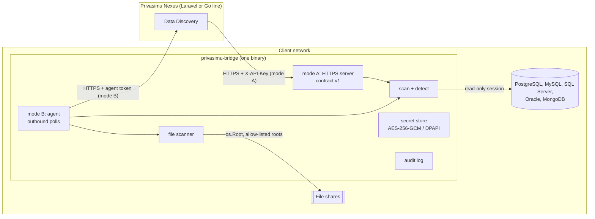

# Privasimu Bridge: design

Status: 0.1.0-dev, 31 October 2026. This repository is a new, standalone bridge for
Privasimu Data Discovery. It was written without access to the Privasimu team's existing
bridge service ("api-data-discovery"); section 13 is a checklist for comparing the two.

What is implemented and tested is stated as such. What is proposed (mode B on the
platform side, file scanning in the platform) is marked **proposal**.

Contents: 1 Purpose · 2 Works with both Privasimu Nexus lines · 3 Architecture ·
4 Threat model · 5 Mode A · 6 Mode B · 7 Data minimisation · 8 Local credentials ·
9 File-server scanning · 10 Detection · 11 Operations · 12 Platform work list ·
13 Comparison checklist · 14 Known gaps.

## 1. Purpose

Data Discovery is Privasimu's personal-data inventory. It has to look inside a client's
network: on-premise databases and file servers. Three facts shape the bridge:

- The platform's old `file` source read the application server's own disk. It was retired
  on 31 October 2026 as a security finding (`FILE_SOURCE_RETIRED`). File servers must now
  be scanned by something installed on the client's side.
- Clients are banks and other regulated companies. Raw personal data must never leave
  their network.
- They dislike opening inbound ports to the internet.

The bridge is one static binary installed on a server inside the client's network. It
reads database catalogs and file shares there, detects personal data there, and sends
out only names, types, categories, counts and confidence. It has two modes:

- **Mode A** (implemented, works today): the platform calls the bridge over HTTPS with the
  existing **contract v1**. No platform change is needed.
- **Mode B** (agent implemented and tested; platform side is a **proposal**): the bridge
  polls the platform and posts results. No inbound port at all.

## 2. Works with both Privasimu Nexus lines (Laravel and Go)

Privasimu Nexus has two backend lines that stay in sync: the Laravel line (`backend`,
priva-back and api-privasimu-nexus) and the Go line (`backend-go`,
go-api-privasimu-nexus). **The same bridge binary works with both.**

- **Mode A**: contract v1 is identical in both lines.
  Laravel `App\Services\Discovery\Bridge\BridgeClient` and Go
  `internal/dbscan/bridge.go` call the same paths (`/v1/name-database-tabels`,
  `/v2/scan-table-columns`) with the same headers (`X-API-Key`, `X-Contract-Version: 1`,
  `User-Agent: privasimu-nexus-discovery`, `Accept` and `Content-Type: application/json`),
  the same body mapping (`BridgeSourceTypes`), the same response checks, retry rules and
  limits. The bridge's test suite replays both clients (section 2.2).
- **Mode B**: the platform side is specified once, in [AGENT-PROTOCOL.md](AGENT-PROTOCOL.md),
  so that Laravel and Go can implement it byte-identically (canonical JSON rules, key
  order, exact error codes and messages in
  [agent-protocol/errors.json](agent-protocol/errors.json), check order, data model).

### 2.1 Why a standalone Go binary and not PHP

The bridge runs on the client's server, not on the platform, so it should ask as little
of that server as possible:

- **Nothing to install besides one file.** A PHP bridge would need PHP, Composer
  packages, a web server or PHP-FPM, and PHP database extensions (`pdo_pgsql`,
  `pdo_mysql`, `sqlsrv`/`pdo_sqlsrv` with the Microsoft ODBC driver, `oci8` with Oracle
  Instant Client, the MongoDB extension). The Go binary is static (`CGO_ENABLED=0`) and
  carries pure-Go drivers: pgx, go-sql-driver/mysql, go-mssqldb, go-ora (no Oracle
  Instant Client) and the official MongoDB driver.
- **The same binary on Windows Server and Linux**, as a Windows service, a systemd unit or
  a distroless container, with no runtime to patch.
- **A smaller attack surface**: no interpreter, no extension loading, HTTP/1.1 only, a
  handful of audited dependencies (THIRD_PARTY_NOTICES.md), memory-safe parsers, and a
  child process for PDF parsing.
- **It does not matter which platform line calls it**: the contract is HTTP and JSON. The
  Go code base also matches the direction of the Go line (`backend-go`), whose host guard
  and contract tests the bridge's own code mirrors.

### 2.2 Differences between the two clients

The two lines implement the contract identically, but their HTTP clients do not send or
read exactly the same bytes. The bridge is tested against both (`internal/server/
lines_test.go`, `platformclient_test.go`):

| Aspect | Laravel (`BridgeClient.php`, Guzzle/curl) | Go (`bridge.go`, net/http) | What the bridge does |
|---|---|---|---|
| Body encoding | `json_encode`: `db_type` first, registry order, `/` and non-ASCII escaped | `encoding/json` of a map: keys sorted, raw UTF-8 | decodes either; identical responses (tested with a password holding `/`, `é` and an emoji) |
| `Accept-Encoding` | none (`decode_content` off) | `gzip` (Go transport default) | never compresses |
| HTTP version | 1.1 (Guzzle) | 1.1 (custom transport) | serves HTTP/1.1 only |
| Column-call concurrency | chunks of 4 (`Http::pool` over `array_chunk`), each waits for its slowest call | sliding window of 4 | `per_source_concurrency: 4`, same results (tested) |
| Response with invalid UTF-8 | `json_decode` fails: the whole response is a contract error | replaced by U+FFFD | never emits invalid UTF-8: such table and column names are left out and counted |
| Connection closed before TLS (`allowed_clients`) | curl error 35 → kind `tls`, message "Sertifikat layanan jembatan tidak tepercaya" | EOF → `bridge_unavailable`, retried | logs each refused address at WARN; troubleshooting covers it |
| Connect timeout | curl error 28 → `timeout` | dial failure in the pinned dialer → `unreachable` | both are retried by the platform |
| Response above 4 MiB | download aborted (curl error 42/63) → `bridge_contract`, even for an error status | status read first, then `bridge_contract` | responses are a few KiB |
| `bridge_url` host | lower-cased; IDN, percent escapes, numeric shorthand refused; one trailing dot dropped | used as parsed | use a plain lower-case DNS name |
| Trusted CAs | the CA bundle PHP/curl uses (`curl.cainfo` / `openssl.cafile` or the system bundle) | the OS trust store (on Linux also `SSL_CERT_FILE`/`SSL_CERT_DIR`) | the install guide covers both |
| Cancellation | none (queue job timeout) | context cancel → `canceled` | not visible to the bridge |
| Same in both | paths, headers, User-Agent, field mapping, 500 tables / 1000 columns / 120 s / 30 s per call / 4 MiB / 4 at once, list retried 3 times (500 ms, 1 s) and column calls never, 401/403 → `auth`, 5xx → `bridge_unavailable`, other non-2xx → `bridge_rejected`, response checks, TLS 1.2+, no redirects, address pinning | | |

## 3. Architecture



| Package | Role |
|---|---|
| `internal/detect` | column-name heuristics, value validators, streaming text counter, column sampler |
| `internal/dbsource` | read-only catalog access and sampling for the five engines; connection pool; error kinds |
| `internal/netguard` | allow-list dialer for platform-supplied addresses (request credentials) |
| `internal/scan` | table analysis and whole-database scans |
| `internal/files` | file roots, safe walker, extractors, reports, PDF child process |
| `internal/server` | mode A |
| `internal/agent` | mode B (`protocol.go` is the wire contract) |
| `internal/config`, `secrets`, `apikey`, `audit`, `i18n`, `service`, `cli` | configuration, secrets, keys, audit, English/Indonesian text, services, command line |

## 4. Threat model

**Assets**: personal data in the client's databases and files; database credentials; the
bridge API key (mode A) and agent token (mode B); the integrity of Privasimu's
inventory; the bridge host itself.

**Trust boundaries**: client network ↔ internet (or the platform); bridge ↔ databases;
bridge ↔ file shares; bridge ↔ local operator.

| Threat | Mitigation | Residual risk |
|---|---|---|
| A compromised platform or a malicious tenant user tries to read data through the bridge | Only names and aggregates exist in the API; no endpoint returns rows, samples or file content (requests for such paths are audited). Mode A local credentials (default): only configured sources, matched by engine/host/database. Mode B: jobs name local ids only; options can only narrow | Metadata (table and column names, counts) is visible to the platform by design |
| The bridge used as a pivot into the internal network (SSRF) | Local credentials by default. Request credentials only for `allowed_targets`; every resolved address checked, connection pinned to the checked address, link-local and metadata ranges never reachable; unlisted names that do not resolve read as blocked (no DNS probing) | An allow-listed range is reachable with credentials the platform supplies |
| Eavesdropping or tampering between platform and bridge | TLS 1.2+ both ways, verified by the platform with its trust store; mode B verifies the platform's certificate; no redirects | A trusted-but-compromised CA |
| API key brute force | 256-bit keys, SHA-256 at rest, constant-time comparison over all keys, lockout after 10 failures, token bucket per address, `allowed_clients` before the TLS handshake | — |
| Leaked API key or agent token | Key ids, expiry and revocation (`key revoke`); agent revocation and rotation with a 10-minute overlap | Until revoked, a leaked key can list names of configured sources |
| Account lockout of the database through retries | Credential and permission failures answer 422, which the platform never retries; failed logins are remembered for a minute | — |
| Load on production databases | Read-only sessions, statement and lock timeouts, at most 4 connections per source, sampling bounded by rows, `READ UNCOMMITTED` and `ApplicationIntent=ReadOnly` on SQL Server, secondaries on MongoDB | Catalog queries on very large catalogs still cost the server some work |
| SQL injection through table names | Names come from the catalog (the platform's name is looked up with bind parameters), identifiers quoted per engine, row limit bound | — |
| A hostile database server | MySQL `LOAD DATA LOCAL INFILE` refused, no clear-text passwords, response sizes bounded by the drivers | Driver bugs |
| Malicious files on a share (links out of the root, junctions, zip bombs, hostile PDFs, FIFOs) | Roots from local configuration only; `os.Root`; links, junctions and special files skipped; non-blocking open and a regular-file re-check; zip sizes checked unsigned and bounded; PDF parsed in a child process with an empty environment and a hard timeout | A parser bug inside the child |
| Secrets on the bridge host | No secret in `bridge.yaml` (literal passwords are a configuration error); encrypted store (AES-256-GCM), key file 0600 or DPAPI machine scope on Windows; secrets printed as `[redacted]` | An administrator or root on the host can read secrets: the store protects copies and backups, not a compromised host |
| Data in logs | The audit log has typed fields only; resolved secrets redact themselves; sampling errors never show driver messages (they can quote values) | Local operational logs can name hosts and databases (for troubleshooting, on the server) |
| Supply chain | Few dependencies with versions pinned in go.sum, `govulncheck` clean, `gosec` clean, base images pinned by digest, no cgo | — |

Out of scope: an attacker with administrator rights on the bridge host; the security of
the platform itself; physical access.

## 5. Mode A: contract v1 (implemented)

### 5.1 Endpoints

| Method and path | Purpose | Auth |
|---|---|---|
| `POST {base}/v1/name-database-tabels` | table names | `X-API-Key` |
| `POST {base}/v2/scan-table-columns` | column names and findings of one table | `X-API-Key` |
| `GET {base}/healthz` | `{"status":"ok"}` | none |
| `POST {base}/ext/v1/file-roots`, `/ext/v1/file-root-report`, `/ext/v1/file-root-scan` | optional file reports (**proposal**, off by default) | `X-API-Key` |

`{base}` is `server.base_path` (empty by default). The platform keeps a path from
`bridge_url`, so `https://gw.example/bridge` calls `/bridge/v1/...`.

Request body (what the platform sends, from `BridgeSourceTypes`):

| Field | Sent for | Bridge use |
|---|---|---|
| `db_type` | all | `postgresql`, `mysql`, `mssql`, `oracle` (and `mongodb` for a future type); `snowflake`, `db2`, `db2i` → 400 |
| `host` | all | local credentials: match key; request credentials: target |
| `port` | optional | request credentials only (engine default otherwise) |
| `database` | all (db2i optional) | match key / target |
| `user`, `password` | all | request credentials only; **ignored** with local credentials |
| `schema_name` | optional | narrows the listing; must be in the source's `schemas` |
| `use_ssl` | optional | request credentials: `verify-full` when true |
| `instance_name`, `trust_server_certificate`, `odbc_driver` | SQL Server | request credentials; `odbc_driver` ignored (pure-Go driver) |
| `service_name`, `sid` | Oracle | request credentials |
| `table_name` | column call | looked up in the catalog |

Responses:

```json
{"status":"success","database":"corebank","tables_scanned":3,"results":["orders","users","audit.log"]}
```
```json
{"status":"success","table":"users","analysis_summary":{"total_columns":5,"pii_columns":4,"pdp_columns":4,"omitted_columns":0,"sampled":true},"column_details":[{"column_name":"kontak","data_type":"character varying(255)","is_pii":true,"is_pdp":true,"pdp_category":"umum","type":"phone","pii_category":"contact","confidence":1,"detection":"content","content":{"sampled":8,"matching":8,"protection_state":"plaintext"}}]}
```

The platform keeps `column_name`, `is_pii` and `pdp_category` and re-applies its own name
rules; the other keys are labels and counts. Names of the default schema are bare, others
`schema.table`, default schema first. `tables_scanned` counts every table found, so a
listing cut by `max_tables` or by names that cannot be stored shows as incomplete.

### 5.2 Status codes and what the platform shows

| Bridge code | HTTP | Platform kind | Retried |
|---|---|---|---|
| `invalid_request`, `unsupported_db_type`, `unsupported_contract_version` | 400 | `bridge_rejected` | no |
| `unauthorized` | 401 | `auth` | no |
| `client_not_allowed` (proxy mode) | 403 | `auth` | no |
| not in `allowed_clients` (file mode) | connection closed before TLS | Go `bridge_unavailable`, Laravel `tls` | Go yes |
| `table_not_found`, `root_not_found`, `not_found` | 404 | `bridge_rejected` (a table becomes `bridge_incomplete`) | no |
| `method_not_allowed` | 405 | `bridge_rejected` | no |
| `report_not_ready` | 409 | `bridge_rejected` | no |
| `payload_too_large` | 413 | `bridge_rejected` | no |
| `unsupported_media_type` | 415 | `bridge_rejected` | no |
| `source_not_allowed`, `schema_not_allowed`, `database_auth_failed`, `database_permission_denied`, `database_not_found`, `database_tls_failed` | 422 | `bridge_rejected` | no |
| `rate_limited`, `locked_out` | 429 | `bridge_rejected` | no |
| `internal_error` | 500 | `bridge_unavailable` | yes |
| `database_unreachable`, `database_error` | 502 | `bridge_unavailable` | yes |
| `busy` | 503 | `bridge_unavailable` | yes |
| `database_timeout` | 504 | `bridge_unavailable` | yes |

The platform retries only the table list (3 attempts); a failing column call marks that
table `bridge_incomplete`, and a 401/403 on a column call fails the whole scan. The
platform never shows the bridge's message; the bridge's log and audit trail do.

The platform's own errors before the bridge is reached: `config` (missing or invalid
fields), `blocked` (the host policy refuses the bridge address), `unreachable`, `tls`,
`timeout`, `bridge_contract` (invalid response), `limit`.

### 5.3 Credential modes

- **local** (default): Privasimu can only scan sources listed in `bridge.yaml`. A request
  matches a source when `db_type` equals its engine, `host` equals its `match.host` (or
  `host`), and `database` equals its `match.database` (or `database`, `service_name`,
  `sid`), case-insensitively. The password typed in Privasimu is ignored; the bridge uses
  the source's own secret. An alias in `match.host` keeps the real address out of
  Privasimu.
- **request**: the settings Privasimu sends are used (the behaviour of contract v1), but
  only for hosts inside `allowed_targets` (section 4).

### 5.4 Network placement and the platform's host policy

The platform checks the bridge address before connecting (`HostPolicy`, identical in both
lines):

- **SaaS**: the address must be public, unless a platform administrator adds the tenant's
  private range to `organizations.settings.discovery_allowed_hosts` (CIDR inside a private
  range, at most /16 or /48, never loopback or metadata). Typical setup: a public DNS
  name, a certificate from a public CA, and a firewall that admits only Privasimu's
  outgoing IPs (also listed in `allowed_clients`). Mode B removes the inbound port.
- **On-premise Privasimu**: private addresses are allowed. The certificate can come from
  the bank's internal CA once that CA is trusted by the Privasimu server (section 2.2).
- Loopback is never allowed (except the platform's development switch), so the bridge
  cannot run on the platform host.

## 6. Mode B: outbound agent

Agent: implemented and tested (`internal/agent`) against an in-memory platform. Platform:
**proposal**, specified normatively in [AGENT-PROTOCOL.md](AGENT-PROTOCOL.md) for both
lines. Summary:

| Route (`/api/bridge-agent/v1`) | Purpose |
|---|---|
| `POST /enroll` | one-time enrollment token → agent id and token |
| `POST /poll` | heartbeat; receives up to 4 leased jobs and the next poll time |
| `PUT /sources` | the agent's inventory (ids, kinds, engines, labels; no hosts, paths or credentials) |
| `POST /jobs/{id}/progress` | renews the 120 s lease; may ask to cancel |
| `POST /jobs/{id}/parts` | numbered result slices, ≤ 1 MiB, idempotent |
| `POST /jobs/{id}/complete` | the result; stored with the existing scan writer |
| `POST /jobs/{id}/fail` | error kind and code only, never a message |
| `POST /token/rotate` | new agent token; the old one works for 600 s |

Authentication: `Authorization: Bearer pvba_…` (SHA-256 at rest, cross-tenant lookup
then the tenant context), `X-Lease-Token` on job routes, `X-Bridge-Protocol: 1` on every
request. Errors: `{"error":{"code","message"}}` with 17 fixed codes. Job types:
`test_source`, `scan_database`, `scan_files`; the platform can lower limits, narrow to an
allowed schema and switch sampling off, never on.

Agent behaviour: polls between `poll_min` (5 s) and `poll_max` (5 min) with jitter;
backs off on errors; on 401 waits the longest interval and tells the operator to enroll
again; abandons a job when its lease is withdrawn (409/404/403); retries 429/5xx with
`Retry-After`; uploads parts of at most 200 items and 512 KiB; supports an HTTP(S) proxy
with credentials from a secret and an extra CA file for an on-premise platform.

## 7. Data minimisation

| Leaves the network | Never leaves |
|---|---|
| table, collection and column names; data types; nullability; row estimates (mode B) | row values, samples, documents |
| PII category codes, UU PDP category (`umum` / `spesifik`), confidence, detection source | the matched values or any part of them |
| counts: sampled values, matching values, per-category counts per file | file content, extracted text |
| protection state of a column (plaintext, masked, encrypted, mixed) from local sampling | keys, ciphertext, masked strings |
| file id (keyed hash), extension, size, modification date; the relative path only with `report_paths: relative` | absolute paths, file owners, the HMAC key |
| source ids and labels you configure (mode B inventory) | hosts, ports, user names, passwords (mode B); passwords (mode A local credentials) |
| error kinds and codes | driver messages (they can quote values or internal names) |

Local sampling is off by default. When on, it reads up to `rows` values per column inside
a read-only transaction on the bridge; each value is examined in memory and dropped. The
tests check that sampled values, file content, paths, hosts and passwords never appear in
any response (mode A) or request (mode B).

## 8. Local credentials

Sources are defined in `bridge.yaml` and referenced by id (mode B) or matched (mode A).
Their secrets are references:

- `secret:NAME`: the encrypted store (`secrets.enc`, AES-256-GCM with a 32-byte key in
  `secrets.key`; on Windows the key is sealed with DPAPI in machine scope and the folder
  is restricted to Administrators, SYSTEM and the service account);
- `env:NAME`: an environment variable;
- `file:PATH`: a file such as a Docker secret or a systemd credential.

A literal password in the file is a validation error that never echoes the value.
`privasimu-bridge secret set NAME` reads the value without echo.

## 9. File-server scanning

- Roots are allow-listed in the local configuration only, canonicalised at start
  (symbolic links in the configured path resolved once). Filesystem roots, system
  directories, roots inside the bridge's own data and roots that contain a system
  directory are refused; the bridge's own files inside a root are skipped.
- Every file is opened through `os.Root` (Go 1.24+), which refuses `..` and links that
  leave the root. The walker skips symbolic links, Windows junctions and other reparse
  points, devices, pipes and sockets; it opens files without blocking and re-checks that
  the opened handle is a regular file. Tested with junctions on Windows; symbolic-link
  tests run where links can be created (Linux, or Windows with the privilege).
- Formats: text (UTF-8 and UTF-16), CSV, TSV, JSON, logs, XML/HTML, YAML, SQL, DOCX and XLSX
  (bounded zip/XML decoding), PDF text (child process: empty environment, 30 s, output and
  input caps). Legacy `.doc`/`.xls`, images and scanned PDFs are counted as unsupported.
- Limits per root: files, depth, file size (100 MiB), text per file (16 MiB).
- The local report (with paths) stays in the state folder; `files locate ROOT ID` maps an
  id back to a path. Outbound: per-file counts per category and a root summary.
- Transports: CLI (`files scan`), mode B job `scan_files`, and the optional mode A
  extension endpoints. Scheduled rescans with `refresh_interval`.

## 10. Detection

- **Names**: tokeniser (snake_case, camelCase, digits, glued words split against a
  vocabulary), rule table aligned with the platform's PII categories, vetoes for
  non-person qualifiers (`nama_produk`, `branch_name`) and descriptive suffixes
  (`email_verified_at`, `address_id`), Indonesian specifics (`nik_karyawan` is an employee
  number, `nama_ibu_kandung`, `suku_bunga` is not ethnicity).
- **Values**: NIK (16 digits, province code, regency and district codes, birth date with
  +40 for women, non-zero sequence), KK (same structure, told apart by context), NPWP
  (printed 15-digit format; raw 15 digits with a Luhn check digit; 16-digit entity form),
  BPJS Kesehatan (13 digits, `000…`), BPJS Ketenagakerjaan (11 digits, with context),
  phone numbers (+62, 62, 08; landlines only with +62 or parentheses), e-mail, payment
  cards (issuer ranges, lengths and Luhn), passport and bank account (shape plus context
  words only).
- **Columns**: a value counts when it validates; a column is personal data when at least
  3 values and 20 % of non-empty values match (configurable). Long text values are
  searched for embedded identifiers. Content wins over the name; a column whose values
  are personal data but whose name is not is marked `shadow`.
- **Protection state** from samples: plaintext, masked, encrypted (Laravel Crypt
  payloads, long hex, high-entropy base64), mixed.

## 11. Operations

- **Install**: `init` (configuration, store key, first API key), `secret set`, `check`,
  `service install` (Windows service with delayed automatic start and restart on
  failure, or a hardened systemd unit), Docker image (distroless, non-root, read-only).
- **Logs**: JSON lines to standard error, or `logs/bridge.log` when running as a
  service. **Audit**: `logs/audit.jsonl` (rotated by size), one event per request, job or
  file scan, never a value.
- **Keys**: `key create`, `key list`, `key revoke`; certificates are reloaded when the
  files change (no restart after renewal).
- **Upgrades**: replace the binary and restart the service; the configuration is checked
  strictly (unknown keys are errors).
- **Backups**: `bridge.yaml`, `secrets.key` and `secrets.enc` together (the store is
  useless without its key; a DPAPI-protected key only opens on the same machine).

## 12. Platform work list

Mode A needs **no platform change**. Optional improvements are marked (opt).

**Both backends (Laravel and Go, identical behaviour)**
1. Mode B per AGENT-PROTOCOL.md: migrations for `bridge_agents`, `bridge_agent_sources`,
   `bridge_jobs`, `bridge_job_parts` with RLS policies (and the RLS coverage test); models
   with `BelongsToOrg`; agent-facing routes under `/api/bridge-agent/v1` outside
   `auth:sanctum` with a `bridge.agent` middleware (token lookup by hash inside
   `CurrentOrgContext::lintasTenant()`, then org context, `tenant.db`, `tenant.readonly`);
   its own rate-limit buckets; canonical JSON responses and errors from `errors.json`.
2. Tenant routes `/api/data-discovery/bridge-agents…` and `/bridge-jobs/{id}…`; audit
   entries (`bridge_agent.created`, `.enrolled`, `.revoked`, `.token_rotated`,
   `bridge_job.queued`, `.completed`, `.failed`).
3. Scan wiring: systems with `connection_config.bridge_agent_id` and `bridge_source_key`
   queue jobs from test-connection (202 + job id), scan and the scheduled scanner
   (`privasimu:scan-scheduled-systems` and its Go twin); results through
   `ScanResultWriter::persist` / `dbscan.PersistResult` with the column mapping of
   AGENT-PROTOCOL.md section 7; failures with the texts of section 6.6.
4. New source type `file_share` (category `unstructured`) for file roots on an agent, its
   result shape (`engine: bridge_files`), counts and drift; `mongodb` through an agent.
5. Scheduler: lease expiry every minute; daily pruning of parts and stale pending agents.
6. Owner decision: may every user with `data_discovery,write` create and revoke agents,
   or only tenant admins (an RBAC change; ask first).
7. (opt) Mode A: register `mongodb` in `BridgeSourceTypes` (the bridge already accepts
   it); log the bridge's error `code` from the response body for support (the message
   shown to users stays the platform's).
8. (opt) Mode A file endpoints (`/ext/v1/...`) as an alternative to mode B for file shares.

**Both frontends (frontend and frontend-go, identical code)**
1. Data Discovery source form: a connection method choice for database types — direct,
   bridge service (mode A, today's `FieldJembatanSumber`), bridge agent (mode B: agent
   picker, then a source picker filtered by engine from the agent's inventory).
2. A "File share (via bridge)" source type: agent and root picker; a files tab (summary
   cards, per-category totals, file list with id, extension, size, date and categories).
3. Settings → Data Discovery → Bridge agents: list with online state, version, last seen,
   source count; create (enrollment token shown once with the install command); renew
   token; rename; rotate; revoke; delete.
4. Asynchronous test connection and scan for agent systems: poll `GET /bridge-jobs/{id}`,
   show progress and the Indonesian failure texts by code.
5. i18n keys in `id`, `en` and `ja` for every new label; user-facing text says "pihak ketiga" / "third party", never the forbidden supplier word.
6. Tutorial pages through the integration tutorial engine (`src/lib/integrasi`) based on
   docs/INSTALL.id.md and docs/INSTALL.en.md, with screenshots once the UI exists.

## 13. Comparison checklist (against the Privasimu "api-data-discovery" bridge)

Fill the right column after reviewing the other repository. Inferences about the other
service come only from the platform's tests and are marked as such.

| # | Question | privasimu-bridge (this repository) | api-data-discovery |
|---|---|---|---|
| 1 | Endpoints that return rows, samples or file content? | none; requests for such paths answer 404 and are audited | platform code says scan-table, scan-database and scan-file exist and return rows or raw values |
| 2 | Contract v1 compatible (paths, shapes, `tables_scanned`, `table` echo)? | yes, replayed from both platform clients | yes (it defines contract v1) |
| 3 | Values in column responses? | none; keys are labels and counts | platform fakes show `type`, `pii_category`, `pdp_category`, `impact` (check for values) |
| 4 | Error body format | `{"status":"error","code","message"}` | platform fakes use `{"detail": …}` (FastAPI style; likely Python) |
| 5 | Runtime to install on the client server | one static binary | check: Python, packages, ODBC drivers (`odbc_driver` field), Oracle client |
| 6 | TLS terminated by the service? Minimum version? Certificate reload? | yes or via a proxy; 1.2+; reload without restart | ? |
| 7 | API key storage and comparison | SHA-256 at rest, constant time, ids, expiry, revocation, lockout | ? |
| 8 | Rate and concurrency limits | per address, global, per source; 422 for credential errors | ? |
| 9 | Inbound port required? | mode A yes; mode B no | ? |
| 10 | Client IP allow-list | `allowed_clients`, before the TLS handshake | ? |
| 11 | Where database passwords live | local secret store by default; platform-supplied only with `credentials: request` | platform sends them on every call |
| 12 | Can the platform make it connect anywhere? | no: local sources, or `allowed_targets` with pinned resolution and metadata blocked | ? |
| 13 | Read-only sessions and timeouts on the databases | yes, per engine | ? |
| 14 | Indonesian identifier validators (NIK structure, NPWP, KK, BPJS, Luhn) | yes | ? |
| 15 | Content sampling, and where values go | optional, local only, counts out | ? |
| 16 | Engines | PostgreSQL, MySQL/MariaDB, SQL Server, Oracle, MongoDB | platform registry: PostgreSQL, MySQL, SQL Server, Oracle, Snowflake, Db2, Db2 for i (+ fields hinting at BigQuery, Athena, Databricks) |
| 17 | File-share scanning: who chooses the path? | local allow-list only; `os.Root`; links and junctions skipped | `scan-file` exists (check whether the caller supplies the path) |
| 18 | Parser isolation for complex formats | PDF in a child process with a timeout | ? |
| 19 | Logging of values or passwords | none (typed audit, redacted secrets) | ? |
| 20 | Service packaging (Windows service, systemd, Docker, non-root) | all three, hardened | ? |
| 21 | Dependency hygiene (pinned, vulnerability scan, SBOM) | go.sum, govulncheck and gosec clean, digest-pinned images, notices | ? |
| 22 | Tests (contract, security, minimisation) | 113 test functions (122 with subtests, many table-driven), incl. both platform clients and a fake platform | ? |
| 23 | Outbound-only mode | mode B (agent ready; platform proposal) | ? |
| 24 | Operator tooling (config check, bilingual messages, health check) | `check`, `--lang id`, `healthcheck` | ? |

## 14. Known gaps

- Mode B and file scanning need the platform work of section 12 in both lines and both
  frontends; until then mode B runs only against the test platform.
- No database integration test was run in this environment (no database server was
  available); they exist behind the `integration` build tag with fixtures for all five
  engines. Linux-only paths (symbolic links, systemd install) were compiled and vetted on
  Windows, not executed.
- Db2 and Db2 for i are not supported (no pure-Go driver); Snowflake is a cloud service
  the platform can scan directly.
- Scanned PDFs and images (OCR), legacy Office formats, encrypted documents and archives
  inside shares are counted, not read.
- Name heuristics and the NPWP check digit (DJP does not publish the algorithm; Luhn is
  what common validators use) can miss or over-report; content sampling reduces both.
- Mode A response bodies are for operators; the platform shows its own generic messages,
  so the bridge's audit log is the place to see the real cause.
- The local secret store protects copies and backups of the configuration folder; it does
  not protect against an administrator of the bridge host.
- No automatic certificate issuance (ACME); certificates come from the operator's CA or a
  reverse proxy.
